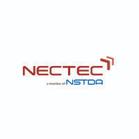
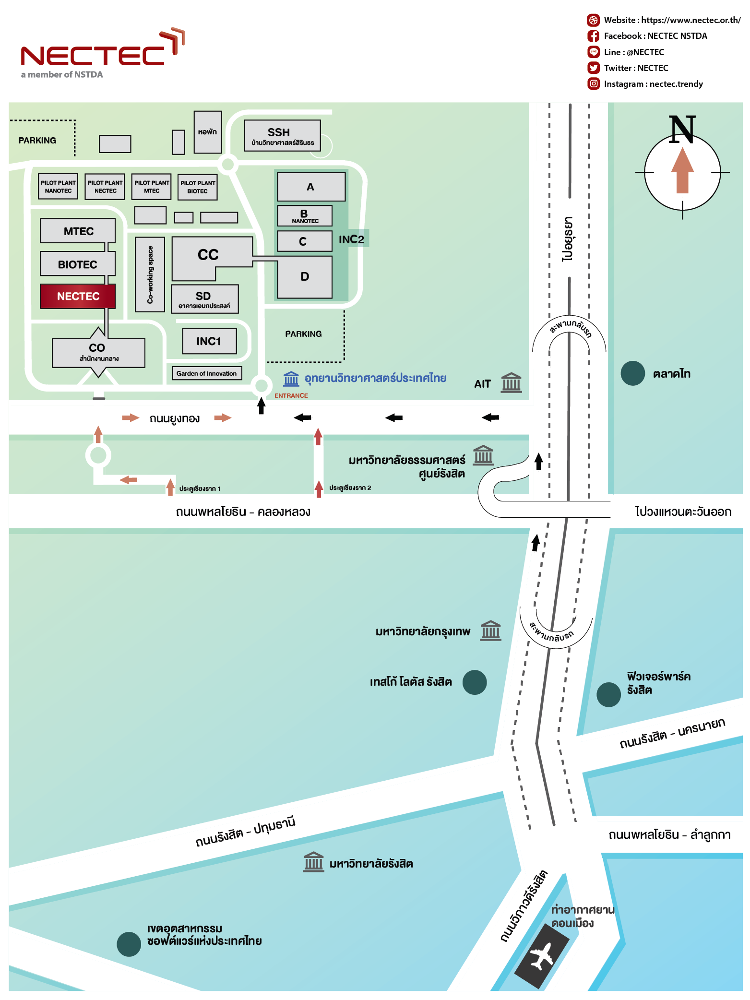
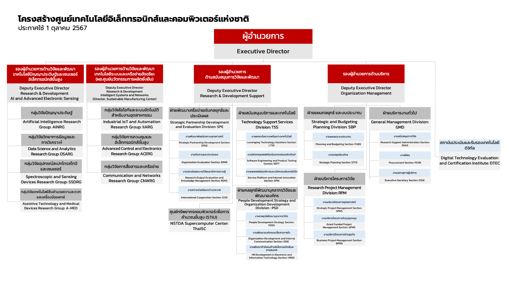

# บทที่ 1 ภาพรวมของสถานประกอบการ

ในการดำเนินการปฏิบัติสหกิจศึกษาจำเป็นต้องทราบข้อมูลเบื้องต้นของสถานประกอบการ เพื่อให้ได้ทราบเกี่ยวกับ ประวัติของสถานประกอบการ วัตถุประสงค์ของสถานประกอบการ การทำงานของสถานประกอบการในแผนก ได้ดังต่อไปนี้

---

## 1.1 ชื่อและที่ตั้งของสถานประกอบการ

**ชื่อสถานประกอบการ (ภาษาไทย):** ศูนย์เทคโนโลยีอิเล็กทรอนิกส์และคอมพิวเตอร์แห่งชาติ สำนักงานพัฒนาวิทยาศาสตร์และเทคโนโลยีแห่งชาติ  
**ชื่อสถานประกอบการ (ภาษาอังกฤษ):** National Electronics and Computer Technology Center (NECTEC), National Science and Technology Development Agency (NSTDA)  
**ที่ตั้ง:** เลขที่ 112 อุทยานวิทยาศาสตร์ประเทศไทย ถนนพหลโยธิน ตำบลคลองหนึ่ง อำเภอคลองหลวง จังหวัดปทุมธานี 12120  
**โทรศัพท์:** 0-2564-6900  
**โทรสาร:** 0-2564-6901–3  
**เว็บไซต์:** https://www.nectec.or.th  

ทั้งนี้ สัญลักษณ์ของศูนย์เทคโนโลยีอิเล็กทรอนิกส์และคอมพิวเตอร์แห่งชาติ (NECTEC) แสดงดังรูปที่ 1.1 และแผนที่ตั้งของศูนย์เทคโนโลยีอิเล็กทรอนิกส์และคอมพิวเตอร์แห่งชาติ ภายในอุทยานวิทยาศาสตร์ประเทศไทย จังหวัดปทุมธานี แสดงดังรูปที่ 1.2

  
**รูปที่ 1.1** สัญลักษณ์ศูนย์เทคโนโลยีอิเล็กทรอนิกส์และคอมพิวเตอร์แห่งชาติ (NECTEC)

  
**รูปที่ 1.2** แผนที่ตั้งของศูนย์เทคโนโลยีอิเล็กทรอนิกส์และคอมพิวเตอร์แห่งชาติ

---

## 1.2 ประวัติองค์กร

ศูนย์เทคโนโลยีอิเล็กทรอนิกส์และคอมพิวเตอร์แห่งชาติ หรือ เนคเทค (NECTEC) ก่อตั้งขึ้นเมื่อวันที่ 16 กันยายน พ.ศ. 2529 โดยมีสถานะเป็นโครงการภายใต้ศูนย์เทคโนโลยีเพื่อการพัฒนา กระทรวงวิทยาศาสตร์ เทคโนโลยีและการพลังงาน เพื่อทำหน้าที่ส่งเสริมและสนับสนุนการวิจัยและพัฒนาเทคโนโลยีด้านอิเล็กทรอนิกส์และคอมพิวเตอร์ของประเทศไทย ต่อมาเมื่อวันที่ 30 ธันวาคม พ.ศ. 2534 ได้มีการประกาศใช้พระราชบัญญัติพัฒนาวิทยาศาสตร์และเทคโนโลยี พ.ศ. 2534 ส่งผลให้มีการจัดตั้งสำนักงานพัฒนาวิทยาศาสตร์และเทคโนโลยีแห่งชาติ (สวทช.) ขึ้น และศูนย์เทคโนโลยีอิเล็กทรอนิกส์และคอมพิวเตอร์แห่งชาติได้เปลี่ยนสถานะเป็นศูนย์แห่งชาติหนึ่งในสังกัดของ สวทช. โดยมีบทบาทหลักในการสร้างฐานรากทางเทคโนโลยีดิจิทัลขั้นสูงให้แก่ประเทศ

ตลอดระยะเวลาการดำเนินงานกว่า 3 ทศวรรษ เนคเทคมีบทบาทสำคัญในการบุกเบิกโครงสร้างพื้นฐานด้านเทคโนโลยีสารสนเทศของประเทศไทย เช่น การพัฒนาเครือข่ายอินเทอร์เน็ตเพื่อการศึกษาและวิจัยในยุคเริ่มต้น การพัฒนาเทคโนโลยีการประมวลผลภาษาธรรมชาติภาษาไทย (Thai Natural Language Processing) เทคโนโลยีการรู้จำและสังเคราะห์เสียงพูด (Speech Recognition and Synthesis) ระบบสมองกลฝังตัว (Embedded Systems) และเทคโนโลยีปัญญาประดิษฐ์ (Artificial Intelligence) ตลอดจนการร่วมมือกับหน่วยงานพันธมิตรทางวิชาการและวิชาชีพ อาทิ สมาคมปัญญาประดิษฐ์ประเทศไทย (AIAT) ในการสร้างระบบนิเวศด้านปัญญาประดิษฐ์และพัฒนากำลังคนด้านเทคโนโลยีดิจิทัลเพื่อขับเคลื่อนเศรษฐกิจและสังคมของประเทศไทยอย่างยั่งยืน

---

## 1.3 ลักษณะการประกอบการ

ศูนย์เทคโนโลยีอิเล็กทรอนิกส์และคอมพิวเตอร์แห่งชาติ เป็นองค์กรวิจัยและพัฒนา (Research and Development Organization) ของภาครัฐที่มีภารกิจหลักในการศึกษา ค้นคว้า วิจัย และพัฒนาเทคโนโลยีด้านอิเล็กทรอนิกส์ คอมพิวเตอร์ โทรคมนาคม สารสนเทศ และปัญญาประดิษฐ์ เพื่อนำไปประยุกต์ใช้ในการยกระดับขีดความสามารถในการแข่งขันของภาคอุตสาหกรรม ภาคการศึกษา ภาคการเกษตร ภาคสาธารณสุข และการบริการภาครัฐ โดยแบ่งกลุ่มงานวิจัยและบริการหลักออกเป็น 4 ด้านสำคัญ ได้แก่

1. **ด้านปัญญาประดิษฐ์และวิทยาการข้อมูล (Artificial Intelligence and Data Science):** วิจัยและพัฒนาเทคโนโลยีการประมวลผลภาษาธรรมชาติ (NLP) เทคโนโลยีการประมวลผลสัญญาณเสียงและคำพูด (Speech and Audio Processing) คอมพิวเตอร์วิทัศน์ (Computer Vision) และการวิเคราะห์ข้อมูลขนาดใหญ่ (Big Data Analytics) รวมถึงการให้บริการแพลตฟอร์มปัญญาประดิษฐ์แห่งชาติ (เช่น AI FOR THAI)
2. **ด้านระบบไซเบอร์-กายภาพและอินเทอร์เน็ตของสรรพสิ่ง (Cyber-Physical Systems and IoT):** วิจัยและพัฒนาเทคโนโลยีเซ็นเซอร์ ระบบสมองกลฝังตัว ระบบอัตโนมัติสำหรับภาคอุตสาหกรรมการผลิต และเทคโนโลยีเกษตรอัจฉริยะ (Smart Farming)
3. **ด้านความมั่นคงปลอดภัยไซเบอร์และโครงสร้างพื้นฐานข้อมูล (Cybersecurity and Data Infrastructure):** พัฒนามาตรฐานการแลกเปลี่ยนข้อมูลภาครัฐ สถาปัตยกรรมคลังข้อมูล การคุ้มครองข้อมูลส่วนบุคคล (PDPA Compliance) และการรักษาความมั่นคงปลอดภัยของระบบสารสนเทศ
4. **ด้านการถ่ายทอดเทคโนโลยีและพัฒนากำลังคน (Technology Transfer and Human Resource Development):** ถ่ายทอดผลงานวิจัยสู่การใช้ประโยชน์เชิงพาณิชย์และสาธารณประโยชน์ ร่วมกับสถาบันการศึกษาและสมาคมวิชาชีพในการบ่มเพาะนักวิจัยและบุคลากรด้านปัญญาประดิษฐ์ผ่านโครงการสหกิจศึกษาและโครงการวิจัยร่วม

---

## 1.4 รูปแบบและการบริหารงานขององค์กร

ศูนย์เทคโนโลยีอิเล็กทรอนิกส์และคอมพิวเตอร์แห่งชาติ มีรูปแบบการบริหารงานแบบองค์กรวิจัยสมัยใหม่ที่มุ่งเน้นผลสัมฤทธิ์เชิงยุทธศาสตร์ (Strategic Research Governance) ภายใต้การกำกับดูแลของสำนักงานพัฒนาวิทยาศาสตร์และเทคโนโลยีแห่งชาติ (สวทช.) โดยมีวิสัยทัศน์ นโยบาย และโครงสร้างองค์กรดังนี้

### 1.4.1 วิสัยทัศน์

"เป็นองค์กรหลักในการสร้างฐานรากทางเทคโนโลยีอิเล็กทรอนิกส์และสารสนเทศขั้นสูงของประเทศ เพื่อขับเคลื่อนเศรษฐกิจและสังคมดิจิทัลอย่างยั่งยืนด้วยวิทยาศาสตร์ เทคโนโลยี และนวัตกรรม"

### 1.4.2 นโยบาย

1. มุ่งเน้นการวิจัยและพัฒนาเทคโนโลยีเชิงลึก (Deep Technology) ด้านอิเล็กทรอนิกส์ คอมพิวเตอร์ และปัญญาประดิษฐ์ ที่ตอบโจทย์ความต้องการของประเทศและสามารถนำไปใช้งานได้จริง
2. ส่งเสริมการบูรณาการข้อมูลและพัฒนามาตรฐานข้อมูลเปิด (Open Data Standards) ตลอดจนการบริหารจัดการข้อมูลอย่างมีธรรมาภิบาลและสอดคล้องกับกฎหมายคุ้มครองข้อมูลส่วนบุคคล
3. สร้างเครือข่ายความร่วมมือกับสถาบันการศึกษา หน่วยงานภาครัฐ ภาคเอกชน และสมาคมวิชาชีพด้านปัญญาประดิษฐ์ เพื่อยกระดับทักษะกำลังคนและขยายผลนวัตกรรมสู่วงกว้าง
4. บริหารจัดการองค์กรด้วยหลักธรรมาภิบาล ความโปร่งใส และการพัฒนาอย่างต่อเนื่อง

### 1.4.3 โครงสร้างองค์กร

การบริหารงานของศูนย์เทคโนโลยีอิเล็กทรอนิกส์และคอมพิวเตอร์แห่งชาติ อยู่ภายใต้การนำของผู้อำนวยการศูนย์ฯ และรองผู้อำนวยการศูนย์ฯ ที่กำกับดูแลสายงานวิจัยและสายงานสนับสนุนต่างๆ ได้แก่ กลุ่มวิจัยปัญญาประดิษฐ์ (Artificial Intelligence Research Group: AINRG) กลุ่มวิจัยวิทยาการข้อมูลและการวิเคราะห์ กลุ่มวิจัยการสื่อสารและเครือข่าย กลุ่มวิจัยระบบอัตโนมัติและอิเล็กทรอนิกส์ และฝ่ายบริหารจัดการองค์กร ดังแสดงโครงสร้างการบริหารองค์กรในรูปที่ 1.3

  
**รูปที่ 1.3** โครงสร้างการบริหารองค์กรของศูนย์เทคโนโลยีอิเล็กทรอนิกส์และคอมพิวเตอร์แห่งชาติ

---

## 1.5 ตำแหน่งและลักษณะงานที่นักศึกษาได้รับมอบหมาย

ในการปฏิบัติงานสหกิจศึกษาครั้งนี้ ผู้จัดทำได้รับมอบหมายให้ปฏิบัติงานในตำแหน่ง **นักศึกษาสหกิจศึกษาด้านการวิเคราะห์ข้อมูลการเรียนรู้และวิศวกรรมข้อมูลปัญญาประดิษฐ์ (Learning Analytics & AI Data Engineering Trainee)** ภายใต้โครงการวิจัยและพัฒนาแพลตฟอร์มการเรียนรู้ภาษาจีนกลางด้วยปัญญาประดิษฐ์ ("语 ปากจีน") โดยมีลักษณะงานและขอบเขตความรับผิดชอบหลัก 6 ด้าน ตามแผนการดำเนินงาน 16 สัปดาห์ ดังนี้

1. **การกำหนดกรอบการวิเคราะห์การเรียนรู้และคำถามวิจัย (Learning Analytics & Learning Questions):** ศึกษากรอบแนวคิด Learning Analytics และงานวิจัยด้านระบบฝึกออกเสียงด้วยคอมพิวเตอร์ (Computer-Assisted Pronunciation Training: CAPT) เพื่อกำหนดคำถามการเรียนรู้เชิงประจักษ์ (Learning Questions: LQ1–LQ8) และตัวชี้วัดทางสัทศาสตร์
2. **การออกแบบมาตรฐานข้อมูล xAPI Telemetry และสถาปัตยกรรมคลังข้อมูลภายใต้กฎหมาย PDPA:** ออกแบบโครงสร้างข้อมูลเหตุการณ์การเรียนรู้ตามมาตรฐาน Experience API (xAPI / IEEE 9274.1.1) พัฒนาระบบคัดกรองความยินยอม (PDPA Consent Gatekeeper) ภายใต้หลักการไม่จัดเก็บไฟล์เสียงดิบของผู้เรียน (Zero Audio Storage at Rest) และออกแบบคลังข้อมูลแบบสองชั้น (Dual-Database Data Warehouse) บนฐานข้อมูล Turso (libSQL) และ Neon (PostgreSQL)
3. **การสร้างอนุกรมวิธานความผิดพลาด (Error Taxonomy) และตัววัดคุณภาพการออกเสียง:** พัฒนาโมดูลจำแนกความผิดพลาดระดับหน่วยเสียงพยัญชนะต้น (Initials) สระ (Finals) และวรรณยุกต์ (Tones) ออกเป็น 4 สถานะ (`correct`, `substitution`, `omission`, `insertion`) พร้อมคำนวณตัวชี้วัด Goodness of Pronunciation (GOP), Phoneme Error Rate (PER) และคะแนนรูปร่างวรรณยุกต์ตามมาตรวัด Chao's Pitch Scale (1–5)
4. **การพัฒนาโมเดลผู้เรียน (Mastery / Knowledge Tracing) และระบบแนะนำบทเรียนซ่อมเสริม (Recommendation Engine):** พัฒนาอัลกอริทึมคำนวณระดับความเชี่ยวชาญของผู้เรียนด้วยวิธี Exponential Moving Average (EMA) ร่วมกับโมเดลการคงอยู่ของความรู้ตามทฤษฎี Ebbinghaus Forgetting Curve และสร้างระบบ Adaptive Remedial Engine และ Student Coach เพื่อคัดเลือกคำศัพท์ซ่อมเสริมที่ตรงกับจุดอ่อนรายบุคคล
5. **การพัฒนาแดชบอร์ดสำหรับผู้เรียนและผู้สอน (Learner & Instructor Diagnostic Dashboard):** ออกแบบและพัฒนาหน้าจอแดชบอร์ดสำหรับผู้เรียน (6-Axis Skill Radar และ AI Coach Recommendations) และแดชบอร์ดวินิจฉัยเชิงลึกสำหรับผู้สอนและผู้ดูแลระบบจำนวน 12 มุมมอง
6. **การประเมินผลสัมฤทธิ์ทางการเรียนและความพึงพอใจ:** เก็บข้อมูลนำร่องจากผู้เรียน วิเคราะห์ผลการทดสอบก่อนเรียนและหลังเรียน (Pre-test / Post-test) ด้วยสถิติเชิงอนุมาน (Paired Sample $t$-test, Cohen's $d$, Hake's Normalized Gain) ประเมินความพึงพอใจและการใช้งานระบบ (Usability) ตลอดจนจัดทำคู่มือและส่งมอบระบบ

---

## 1.6 พนักงานที่ปรึกษาและตำแหน่งงานหรือแผนกของพนักงานที่ปรึกษา

- **ชื่อ-นามสกุลพนักงานที่ปรึกษา:** คุณภูวิศ เกิดปราโมทย์  
- **ตำแหน่งงาน:** หัวหน้าฝ่ายเทคนิคและปัญญาประดิษฐ์ (Head of Technical and Artificial Intelligence)  
- **แผนก / หน่วยงาน:** สมาคมปัญญาประดิษฐ์ประเทศไทย (Artificial Intelligence Association of Thailand: AIAT) ปฏิบัติงานร่วมโครงการวิจัยและพัฒนาระบบเทคโนโลยีการศึกษาอัจฉริยะกับศูนย์เทคโนโลยีอิเล็กทรอนิกส์และคอมพิวเตอร์แห่งชาติ (NECTEC)

---

## 1.7 ระยะเวลาที่ปฏิบัติงาน

ผู้จัดทำได้เข้าปฏิบัติงานสหกิจศึกษาตั้งแต่วันที่ **4 มิถุนายน พ.ศ. 2569 ถึง วันที่ 20 พฤศจิกายน พ.ศ. 2569** รวมระยะเวลาทั้งสิ้น **16 สัปดาห์** (คิดเป็นจำนวนวันปฏิบัติงานรวม 122 วันทำการ หรือ 976 ชั่วโมงปฏิบัติงาน) โดยปฏิบัติงานในวันจันทร์ถึงวันศุกร์ เวลา 08.30 น. ถึง 17.30 น.

---

## 1.8 แผนการปฏิบัติงานสหกิจศึกษา

ในการปฏิบัติงานสหกิจศึกษาตลอดระยะเวลา 16 สัปดาห์ ผู้จัดทำและพนักงานที่ปรึกษาได้ร่วมกันวางแผนการดำเนินงานออกเป็น 16 กิจกรรมหลัก ครอบคลุมตั้งแต่การศึกษาองค์กร การกำหนดคำถามการเรียนรู้ การออกแบบสถาปัตยกรรม xAPI และ PDPA การพัฒนาส่วนเก็บข้อมูลและ Error Taxonomy การเก็บข้อมูลนำร่อง การพัฒนาโมเดลผู้เรียนและระบบแนะนำบทเรียน การพัฒนาแดชบอร์ดผู้เรียนและผู้สอน ไปจนถึงการประเมินผลและส่งมอบงาน ดังแสดงรายละเอียดในตารางที่ 1.1

### ตารางที่ 1.1 แผนการปฏิบัติงานสหกิจศึกษาตลอดระยะเวลา 16 สัปดาห์

| ที่ | กิจกรรม | 1 | 2 | 3 | 4 | 5 | 6 | 7 | 8 | 9 | 10 | 11 | 12 | 13 | 14 | 15 | 16 |
| :-: | :--- | :-: | :-: | :-: | :-: | :-: | :-: | :-: | :-: | :-: | :-: | :-: | :-: | :-: | :-: | :-: | :-: |
| 1 | ศึกษาองค์กร ระบบงาน และเครื่องมือ | ■ | ■ | | | | | | | | | | | | | | |
| 2 | กำหนด learning questions และตัวชี้วัด | ■ | ■ | | | | | | | | | | | | | | |
| 3 | ศึกษากรอบ Learning Analytics + งานวิจัย CAPT | | ■ | ■ | | | | | | | | | | | | | |
| 4 | Spike: pipeline วิเคราะห์เสียง + ขออนุมัติจริยธรรม/PDPA | | | ■ | ■ | | | | | | | | | | | | |
| 5 | ออกแบบ learning event schema (xAPI) และ data warehouse | | | ■ | ■ | ■ | | | | | | | | | | | |
| 6 | พัฒนาส่วนเก็บข้อมูล (แอปฝึกพูด + logging) | | | | | ■ | ■ | ■ | ■ | | | | | | | | |
| 7 | สร้าง error taxonomy และตัววัดคุณภาพการออกเสียง | | | | | | ■ | ■ | ■ | | | | | | | | |
| 8 | เริ่มเก็บข้อมูลจากผู้เรียนจริง (นำร่อง) | | | | | | | | ■ | ■ | ■ | ■ | ■ | ■ | | | |
| 9 | พัฒนาโมเดลผู้เรียน (mastery / knowledge tracing) | | | | | | | | | ■ | ■ | ■ | | | | | |
| 10 | พัฒนา recommendation engine | | | | | | | | | | ■ | ■ | ■ | | | | |
| 11 | พัฒนา dashboard ผู้เรียนและผู้สอน | | | | | | | | | | | ■ | ■ | ■ | | | |
| 12 | ประเมินผล: pre/post test + ความพึงพอใจ + usability | | | | | | | | | | | | ■ | ■ | ■ | | |
| 13 | วิเคราะห์ผลและปรับปรุงระบบ | | | | | | | | | | | | | ■ | ■ | ■ | |
| 14 | Deploy + คู่มือ + ส่งมอบงาน | | | | | | | | | | | | | | ■ | ■ | |
| 15 | จัดทำรายงาน โปสเตอร์ และนำเสนอ | | | | | | | | | | | | | ■ | ■ | ■ | ■ |
| 16 | บันทึกประจำสัปดาห์ / รายงานความก้าวหน้า | ■ | ■ | ■ | ■ | ■ | ■ | ■ | ■ | ■ | ■ | ■ | ■ | ■ | ■ | ■ | ■ |
