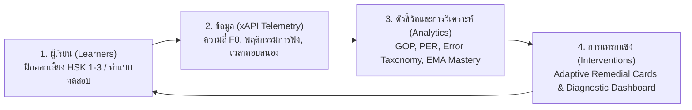

# บทที่ 3 ทฤษฎีและงานวิจัยที่เกี่ยวข้อง

ในการพัฒนาระบบวิเคราะห์ข้อมูลการเรียนรู้และแดชบอร์ดวินิจฉัยการออกเสียงภาษาจีนเชิงสัทศาสตร์ตามมาตรฐาน xAPI ภายใต้การคุ้มครองข้อมูลส่วนบุคคล ผู้จัดทำได้ศึกษาค้นคว้าแนวคิด ทฤษฎี มาตรฐานทางวิศวกรรมข้อมูล และงานวิจัยที่เกี่ยวข้อง เพื่อนำมาใช้เป็นรากฐานทางวิชาการในการออกแบบและพัฒนาระบบ โดยแบ่งเนื้อหาออกเป็น 3 ส่วนหลัก ได้แก่ แนวคิดและทฤษฎีที่เกี่ยวข้อง เครื่องมือ ภาษา และเทคโนโลยีที่ใช้ในการพัฒนา และงานวิจัยที่เกี่ยวข้อง ดังรายละเอียดต่อไปนี้

---

## 3.1 แนวคิดและทฤษฎีที่เกี่ยวข้อง

### 3.1.1 กรอบการวิเคราะห์ข้อมูลการเรียนรู้ (Learning Analytics) และระบบฝึกออกเสียงด้วยคอมพิวเตอร์ (CAPT)

การวิเคราะห์ข้อมูลการเรียนรู้ (Learning Analytics: LA) ตามคำนิยามของสมาคมวิจัยการวิเคราะห์การเรียนรู้ (Society for Learning Analytics Research: SoLAR) คือ การวัด การเก็บรวบรวม การวิเคราะห์ และการรายงานข้อมูลเกี่ยวกับผู้เรียนและบริบทของการเรียนรู้ โดยมีจุดมุ่งหมายเพื่อทำความเข้าใจและปรับปรุงกระบวนการเรียนรู้ตลอดจนสภาพแวดล้อมที่การเรียนรู้นั้นเกิดขึ้นให้มีประสิทธิภาพสูงสุด วงจรการทำงานของระบบ Learning Analytics ตามแนวคิดของ Clow (2012) [1] ประกอบด้วย 4 ขั้นตอนที่หมุนเวียนต่อเนื่องกันเป็นวงจรปิด (Closed-Loop Learning Analytics Cycle) ดังแสดงในรูปที่ 3.1 ได้แก่
1. **ผู้เรียน (Learners):** ผู้เรียนทำกิจกรรมการเรียนรู้ เช่น การฝึกออกเสียงคำศัพท์ การทำแบบฝึกหัดในด่านเควสต์ หรือการทำแบบทดสอบวัดระดับ
2. **ข้อมูล (Data):** ระบบดักจับร่องรอยพฤติกรรมการเรียนรู้ (Digital Traces) เช่น จำนวนครั้งที่กดฟังเสียงตัวอย่าง เวลาที่ใช้คิดก่อนพูด (Hesitation Latency) และค่าพารามิเตอร์ทางสัทศาสตร์
3. **ตัวชี้วัดและการวิเคราะห์ (Metrics & Analytics):** การนำข้อมูลดิบมาประมวลผลด้วยอัลกอริทึมทางสถิติและปัญญาประดิษฐ์เพื่อสร้างตัวชี้วัดความเชี่ยวชาญ อนุกรมวิธานความผิดพลาด และแผนภูมิภาพ (Visualization)
4. **การแทรกแซงและป้อนกลับ (Interventions):** การนำผลการวิเคราะห์กลับไปช่วยเหลือผู้เรียน เช่น การแนะนำคำศัพท์ซ่อมเสริมรายบุคคล หรือการแจ้งเตือนผู้สอนให้ทราบถึงผู้เรียนที่ต้องการความช่วยเหลือพิเศษ


**รูปที่ 3.1** แผนภาพวงจรการวิเคราะห์ข้อมูลการเรียนรู้ (Learning Analytics Cycle) ที่ประยุกต์ใช้ในโครงงาน

เมื่อนำกรอบแนวคิด Learning Analytics มาบูรณาการเข้ากับระบบฝึกออกเสียงด้วยคอมพิวเตอร์ (Computer-Assisted Pronunciation Training: CAPT) จะช่วยยกระดับระบบ CAPT จากเดิมที่ทำหน้าที่เพียงตรวจจับความถี่มูลฐานของเสียง ($F_0$) ด้วยอัลกอริทึมการหาค่าสหสัมพันธ์ในตัวเองเชิงอนุพันธ์ (YIN Pitch Tracking Algorithm) [2] แล้วแจ้งผลว่า "ผ่าน" หรือ "ไม่ผ่าน" ไปสู่ระบบวินิจฉัยเชิงสัทศาสตร์ที่สามารถตอบคำถามวิจัยด้านการเรียนรู้ (Learning Questions) ได้อย่างรอบด้าน ทั้งในระดับรายบุคคลและระดับกลุ่มผู้เรียน

---

### 3.1.2 สัทศาสตร์ภาษาจีนกลาง อนุกรมวิธานความผิดพลาด (Error Taxonomy) และตัววัดคุณภาพการออกเสียง

โครงสร้างพยางค์ในภาษาจีนกลางมาตรฐาน (Standard Mandarin / Putonghua) ประกอบด้วย 3 องค์ประกอบหลัก ได้แก่ พยัญชนะต้น (Initials / 声母 *Shēngmǔ* จำนวน 21 เสียงและพยัญชนะกึ่งสระ `y`, `w`) สระเดี่ยวหรือสระประสม (Finals / 韵母 *Yùnmǔ*) และวรรณยุกต์ (Tones / 声调 *Shēngdiào* จำนวน 4 เสียงหลัก และเสียงเบา 1 เสียง) ในทางสัทศาสตร์กลศาสตร์เสียง จ้าว หยวนเริ่น (Yuen Ren Chao) [3] ได้กำหนดมาตรวัดระดับเสียงวรรณยุกต์ภาษาจีนกลางออกเป็น 5 ระดับ (Chao's Five-Level Tone Letters) ตั้งแต่ระดับ 1 (ต่ำสุด) ถึงระดับ 5 (สูงสุด) โดยสามารถแปลงค่าความถี่มูลฐาน $F_0$ (หน่วยเป็นเฮิรตซ์: Hz) ของผู้พูดแต่ละคนให้อยู่ในมาตรวัดลอการิทึม 1–5 เพื่อขจัดความแตกต่างของช่วงเสียงระหว่างเพศชายและเพศหญิง ดังสมการที่ (3.1)

$$\text{Chao}(t) = 1 + 4 \times \frac{\log_{10}(F_0(t)) - \log_{10}(F_{0,\min})}{\log_{10}(F_{0,\max}) - \log_{10}(F_{0,\min})}$$

โดยลักษณะรูปร่างระดับเสียงของวรรณยุกต์ภาษาจีนกลางทั้ง 4 เสียงหลักและเสียงเบาตามมาตรวัดของจ้าว หยวนเริ่น สามารถสรุปได้ดังแสดงในตารางที่ 3.1

#### ตารางที่ 3.1 ระบบวรรณยุกต์ภาษาจีนกลางตามมาตรวัดระดับเสียงของจ้าว หยวนเริ่น (Chao's Pitch Scale 1–5)

| วรรณยุกต์ | ชื่อภาษาจีน | สัญลักษณ์พินอิน | ค่าตัวเลขระดับเสียง (Chao Scale) | ลักษณะรูปร่างความถี่เสียง (Pitch Contour) | ตัวอย่างคำศัพท์ |
| :-: | :-: | :-: | :-: | :--- | :--- |
| **เสียงที่ 1** | 阴平 (Yīnpíng) | `ā` | **55** | เสียงสูงคงที่ตลอดพยางค์ (High Level) | 妈 (`mā` - แม่) |
| **เสียงที่ 2** | 阳平 (Yángpíng) | `á` | **35** | เสียงไต่ระดับจากกลางขึ้นสูง (High Rising) | 麻 (`má` - ป่าน) |
| **เสียงที่ 3** | 上声 (Shǎngshēng) | `ǎ` | **214** (หรือ **21**) | เสียงกดต่ำลงแล้วตวัดขึ้น (Low Dipping) | 马 (`mǎ` - ม้า) |
| **เสียงที่ 4** | 去声 (Qùshēng) | `à` | **51** | เสียงตกกระทบจากสูงสุดลงต่ำสุดอย่างรวดเร็ว (High Falling) | 骂 (`mà` - ด่า) |
| **เสียงเบา** | 轻声 (Qīngshēng) | `a` | **0** (แปรผัน) | เสียงสั้นและเบา ความสูงขึ้นอยู่กับพยางค์หน้า (Neutral) | 吗 (`ma` - ไหม) |

นอกจากนี้ ภาษาจีนกลางยังมีกฎการแปรเสียงวรรณยุกต์ตามบริบทพยางค์ข้างเคียง (Tone Sandhi) ที่สำคัญที่สุดคือ กฎวรรณยุกต์เสียงที่ 3 ซ้อนกัน (Third-Tone Sandhi: 3+3 $\rightarrow$ 2+3) เช่น คำว่า 你好 (`nǐ hǎo`) ซึ่งพยางค์แรกมีวรรณยุกต์พื้นเดิม (Underlying Tone) เป็นเสียงที่ 3 แต่เมื่อออกเสียงจริงต้องแปรเป็นวรรณยุกต์พื้นผิว (Surface Tone) เสียงที่ 2 (`ní hǎo`) รวมถึงกฎการเปลี่ยนเสียงของคำว่า 不 (`bù` $\rightarrow$ `bú` เมื่อตามด้วยเสียงที่ 4) และ 一 (`yī` $\rightarrow$ `yí` หรือ `yì`)

เพื่อวัดคุณภาพการออกเสียงและจำแนกข้อผิดพลาดของผู้เรียนชาวไทยอย่างเป็นระบบ โครงงานนี้ได้ประยุกต์ใช้อนุกรมวิธานความผิดพลาดระดับหน่วยเสียง (Phoneme-level Error Taxonomy) และตัววัดมาตรฐาน 2 ตัวชี้วัดหลัก [4] ได้แก่

1. **คะแนนความแม่นยำในการออกเสียง (Goodness of Pronunciation: GOP):** ในระบบรู้จำเสียงพูดแบบดั้งเดิมของ Witt และ Young (2000) [4] ค่า GOP คำนวณจากอัตราส่วนความน่าจะเป็นแบบลอการิทึม (Log-Likelihood Ratio) ของหน่วยเสียงเป้าหมาย $p$ ต่อหน่วยเสียงที่มีความน่าจะเป็นสูงสุด ในโครงงานนี้ได้ปรับปรุงสมการ GOP สำหรับประมวลผลแบบกำหนดค่าแน่นอน (Deterministic Acoustic GOP) โดยถ่วงน้ำหนักระหว่างความชัดเจนของสัญญาณคาบเวลาจากอัลกอริทึม YIN ($S_{\text{clarity}}$) ความแม่นยำของรูปร่างวรรณยุกต์และค่าความชัน ($S_{\text{contour}}$) และความแม่นยำของหน่วยเสียงพยัญชนะ/สระ ($S_{\text{segment}}$) ให้อยู่ในช่วงคะแนน 0 ถึง 100 คะแนน ดังสมการที่ (3.2)

$$\text{GOP}_i = \text{ clamp}_{[0, 100]} \left( w_1 S_{\text{segment}, i} + w_2 S_{\text{contour}, i} + w_3 S_{\text{clarity}, i} \right)$$

2. **อัตราความผิดพลาดของหน่วยเสียง (Phoneme Error Rate: PER):** คำนวณจากระยะห่างการแก้ไขแบบเลเวนชไตน์ (Levenshtein Edit Distance) ระหว่างลำดับหน่วยเสียงเป้าหมายและลำดับหน่วยเสียงที่ระบบตรวจจับได้ โดยจำแนกความคลาดเคลื่อนออกเป็น 3 ประเภทในอนุกรมวิธานความผิดพลาด ได้แก่ การออกเสียงแทนที่หรือสับสน ($S$: Substitution เช่น เป้าหมายคือพยัญชนะม้วนลิ้น `zh` แต่ออกเสียงเป็น `z`) การตกหล่นหรือไม่ได้ออกเสียง ($D$: Omission/Deletion) และการแทรกเสียงเกิน ($I$: Insertion) เทียบกับจำนวนหน่วยเสียงเป้าหมายทั้งหมด ($N$) ดังสมการที่ (3.3)

$$\text{PER} = \frac{S + D + I}{N}$$

---

### 3.1.3 มาตรฐานข้อมูลกิจกรรมการเรียนรู้ xAPI (IEEE 9274.1.1) และการคุ้มครองข้อมูลส่วนบุคคล (PDPA)

มาตรฐาน Experience API (xAPI หรือชื่อเดิมคือ Tin Can API) ซึ่งได้รับการรับรองเป็นมาตรฐานสากล IEEE 9274.1.1 [5] เป็นสถาปัตยกรรมข้อมูลสำหรับการแลกเปลี่ยนและจัดเก็บประวัติกิจกรรมการเรียนรู้ในคลังระเบียนการเรียนรู้ (Learning Record Store: LRS) โดยข้อมูลทุกเหตุการณ์จะถูกจัดอยู่ในรูปแบบประโยคโครงสร้าง JSON ที่เรียกว่า **xAPI Statement** ซึ่งประกอบด้วยองค์ประกอบหลัก 3 ส่วน คือ **"ใคร (Actor) ทำกริยาอะไร (Verb) กับวัตถุการเรียนรู้ใด (Object)"** และขยายความด้วยผลลัพธ์ (**Result**) และบริบท (**Context**) ดังนี้
- **Actor:** ข้อมูลระบุตัวตนผู้เรียนที่ผ่านการแฝงชื่อ (Pseudonymized User Account / UUID)
- **Verb:** รหัส URI มาตรฐานของกริยาการเรียนรู้ เช่น `http://adlnet.gov/expapi/verbs/experienced` (การกดฟังเสียงตัวอย่าง) `http://adlnet.gov/expapi/verbs/attempted` (การพยายามออกเสียงพยางค์) และ `http://adlnet.gov/expapi/verbs/scored` (การประเมินผลคะแนนคำศัพท์)
- **Object:** ข้อมูลคำศัพท์หรือด่านการเรียนรู้ เช่น รหัสคำศัพท์ ตัวอักษรจีน (Hanzi) พินอิน และระดับ HSK
- **Result:** คะแนนที่ได้ (`scaled`, `raw`, `min`, `max`) สถานะการผ่านเกณฑ์ (`success`, `completion`) และส่วนขยาย (`extensions`) ที่บรรจุรายละเอียดคะแนน GOP, PER, ความถี่ $F_0$ เฉลี่ย และรายการอนุกรมวิธานความผิดพลาดระดับหน่วยเสียง
- **Context:** ข้อมูลบริบทแวดล้อม เช่น โหมดการฝึก (`stage`, `word`, `assessment`) จำนวนครั้งที่กดฟังเสียงตัวอย่างก่อนพูด และเวลาความลังเลก่อนเริ่มพูด (Hesitation Latency)

ในด้านจริยธรรมข้อมูลและการปฏิบัติตามพระราชบัญญัติคุ้มครองข้อมูลส่วนบุคคล พ.ศ. 2562 (Personal Data Protection Act: PDPA) และระเบียบ GDPR ของสหภาพยุโรป ข้อมูลไฟล์เสียงพูดดิบ (Raw Audio Waveform) ของผู้เรียนถือเป็นข้อมูลส่วนบุคคลที่มีความอ่อนไหวเนื่องจากสามารถนำไปสกัดอัตลักษณ์บุคคลจากเสียง (Voice Biometrics) ได้ โครงงานนี้จึงได้ออกแบบสถาปัตยกรรม **Zero Audio Storage at Rest** ร่วมกับหลักการออกแบบเพื่อความเป็นส่วนตัว (Privacy by Design) โดยประกอบด้วยกลไกสำคัญ 3 ประการ คือ (1) การประมวลผลสัญญาณเสียงเพื่อสกัดความถี่ $F_0$ และทำนายวรรณยุกต์จะดำเนินการภายในหน่วยความจำชั่วคราว (In-Memory Processing) และทำลายบัฟเฟอร์เสียงทิ้งทันทีหลังสกัดค่าตัวเลขเสร็จสิ้น (2) ระบบ **PDPA Consent Gatekeeper** จะตรวจสอบสถานะการให้ความยินยอมของผู้เรียนก่อนบันทึกข้อมูล Telemetry ทุกครั้ง หากผู้เรียนยังไม่ให้ความยินยอมหรือถอนความยินยอม ระบบจะปฏิเสธการบันทึกข้อมูลลงคลังข้อมูลทันที และ (3) การจัดเก็บประวัติการขอความยินยอมและการถอนความยินยอมพร้อมรหัสแฮชของที่อยู่ไอพี (SHA-256 IP Hash) ลงในตารางตรวจสอบ (`user_consent_logs`) เพื่อความโปร่งใสและตรวจสอบย้อนกลับได้

---

### 3.1.4 โมเดลการติดตามความเชี่ยวชาญของผู้เรียน (Mastery & Knowledge Tracing) และระบบแนะนำบทเรียนซ่อมเสริม

ในการประเมินว่าผู้เรียนมีความเชี่ยวชาญ (Mastery) ในหน่วยเสียงหรือวรรณยุกต์ใดอย่างแท้จริง การใช้ค่าเฉลี่ยเลขคณิตแบบธรรมดา (Simple Arithmetic Mean) ของคะแนนทุกครั้งตั้งแต่อดีตมีข้อเสียสำคัญคือ คะแนนที่ต่ำในช่วงเริ่มต้นฝึกหัดจะฉุดรั้งคะแนนรวมไว้ แม้ว่าในระยะหลังผู้เรียนจะสามารถออกเสียงได้อย่างถูกต้องต่อเนื่องแล้วก็ตาม โครงงานนี้จึงได้นำโมเดล **ค่าเฉลี่ยเคลื่อนที่แบบถ่วงน้ำหนักเอ็กซ์โพเนนเชียล (Exponential Moving Average: EMA Mastery Model)** [6] มาใช้ในการติดตามความเชี่ยวชาญของผู้เรียน โดยให้น้ำหนักกับผลการฝึกครั้งล่าสุดมากกว่าอดีตตามค่าพารามิเตอร์การเรียนรู้ $\alpha \in (0, 1)$ (ในระบบกำหนดค่าเริ่มต้น $\alpha = 0.30$) ดังสมการที่ (3.4)

$$M_t = \alpha \cdot S_t + (1 - \alpha) \cdot M_{t-1}$$

โดยที่ $M_t$ คือคะแนนความเชี่ยวชาญสะสมหลังการฝึกครั้งที่ $t$, $S_t$ คือคะแนนการออกเสียงในครั้งที่ $t$ และ $M_{t-1}$ คือคะแนนความเชี่ยวชาญสะสมก่อนหน้า

อย่างไรก็ตาม ความเชี่ยวชาญที่ผู้เรียนเคยทำได้ย่อมเสื่อมถอยลงตามกาลเวลาหากไม่ได้รับการทบทวน ตาม **ทฤษฎีเส้นโค้งการลืมของเอ็บบิงเฮาส์ (Ebbinghaus Forgetting Curve)** [7] ระบบจึงได้ผสานสมการการคงอยู่ของความจำ (Memory Retention: $R$) เข้ากับความแข็งแกร่งของความจำ ($S_{\text{stability}}$ ซึ่งเพิ่มขึ้นตามจำนวนครั้งที่ผู้เรียนทบทวนสำเร็จต่อเนื่อง) และระยะเวลาที่ผ่านไปนับจากการฝึกครั้งล่าสุด ($\Delta t$ หน่วยเป็นวัน) ดังสมการที่ (3.5) และแสดงลักษณะกราฟการคงอยู่ของความรู้และการทบทวนแบบเว้นระยะ (Spaced Repetition) ในรูปที่ 3.2

$$R(\Delta t) = e^{-\frac{\Delta t}{S_{\text{stability}}}}, \quad \text{โดยที่ } S_{\text{stability}} = S_0 \cdot (1 + 0.5 \cdot \min(k, 10)) \cdot \left(0.5 + \frac{M_t}{100}\right)$$

เมื่อนำค่าความเชี่ยวชาญสะสม $M_t$ มาคูณกับอัตราการคงอยู่ของความจำ $R(\Delta t)$ จะได้ **คะแนนความเชี่ยวชาญปรับแก้ตามเวลา (Effective Mastery Score: $M_{\text{eff}} = M_t \cdot R(\Delta t)$)** หากค่า $M_{\text{eff}} < 75\%$ หรือค่า $R(\Delta t) < 70\%$ ระบบจะตั้งสถานะหน่วยเสียงหรือคำศัพท์นั้นว่า "ควรทบทวน (`needsReview = true`)" และส่งรายการหน่วยเสียงพยัญชนะต้นและวรรณยุกต์ที่อ่อนไปยัง **ระบบแนะนำบทเรียนซ่อมเสริม (Adaptive Remedial & Student Coach Engine)** ซึ่งใช้อัลกอริทึมการให้คะแนนความสอดคล้องแบบถ่วงน้ำหนัก (Multi-Criteria Rule-Based Scoring) โดยคำศัพท์ที่มีทั้งพยัญชนะต้นตรงกับจุดอ่อนและมีวรรณยุกต์ตรงกับจุดอ่อน (โดยเฉพาะคำที่มีกฎ Tone Sandhi 3+3) จะได้รับคะแนนลำดับความสำคัญสูงสุดในการนำมาสร้างเป็นการ์ดฝึกซ่อมเสริมรายบุคคล

```
รูปที่ 3.2 กราฟเส้นโค้งการคงอยู่ของความรู้ตามทฤษฎีการลืมของเอ็บบิงเฮาส์ (Ebbinghaus Forgetting Curve)
อัตราการจำได้ R(t) (%)
100% |*                       * (ทบทวนครั้งที่ 1)      * (ทบทวนครั้งที่ 2)
 80% |  *                       *                       *
 60% |    *                       *                       * (ความชันลดลงเมื่อ S เพิ่มขึ้น)
 40% |      *                       *
 20% |        *   R(t) = exp(-t/S)
  0% +-------------------------------------------------------------------> เวลาที่ผ่านไป (วัน)
     0        1               3                       7               14
```

---

### 3.1.5 สถิติเพื่อการประเมินผลสัมฤทธิ์ทางการเรียน (Paired Sample $t$-test, Cohen's $d$ และ Hake's Gain)

เพื่อพิสูจน์ผลสัมฤทธิ์ทางการเรียนของผู้เรียนจากการใช้งานระบบอย่างเป็นวิทยาศาสตร์ โครงงานนี้ได้ฝังโมดูลการคำนวณสถิติเชิงอนุมานและจิตมิติไว้ในระบบวิเคราะห์ข้อมูล (`src/lib/analytics/statisticalEngine.ts`) โดยใช้สถิติมาตรฐาน 3 ส่วน ได้แก่

1. **การทดสอบค่าทีแบบกลุ่มตัวอย่างไม่อิสระ (Paired Sample $t$-test):** ใช้เปรียบเทียบค่าเฉลี่ยของคะแนนทดสอบก่อนเรียน (Pre-test: $X_{\text{pre}}$) และคะแนนทดสอบหลังเรียน (Post-test: $X_{\text{post}}$) ของผู้เรียนคนเดียวกันจำนวน $n$ คน โดยกำหนดผลต่างรายบุคคล $d_i = X_{\text{post}, i} - X_{\text{pre}, i}$ ค่าเฉลี่ยผลต่าง $\bar{d}$ และส่วนเบี่ยงเบนมาตรฐานของผลต่าง $s_d$ สามารถคำนวณค่าสถิติ $t$ ที่องศาอิสระ $df = n - 1$ ได้ดังสมการที่ (3.6)

$$t = \frac{\bar{d}}{s_d / \sqrt{n}}, \quad \text{โดยที่ } s_d = \sqrt{\frac{\sum_{i=1}^{n} (d_i - \bar{d})^2}{n - 1}}$$

2. **ขนาดอิทธิพลของโคเฮน (Cohen's $d$ Effect Size):** ใช้บอกขนาดความสำคัญในทางปฏิบัติของพัฒนาการที่เกิดขึ้นโดยไม่ขึ้นกับขนาดกลุ่มตัวอย่าง คำนวณจากอัตราส่วนระหว่างค่าเฉลี่ยของผลต่างต่อส่วนเบี่ยงเบนมาตรฐานของผลต่าง ($d = \bar{d} / s_d$) โดยมีเกณฑ์การแปลผลตามแนวคิดของ Cohen (1988) [8] คือ $|d| \ge 0.80$ หมายถึงขนาดอิทธิพลระดับสูง (Large Effect), $0.50 \le |d| < 0.80$ ระดับปานกลาง (Medium Effect) และ $0.20 \le |d| < 0.50$ ระดับต่ำ (Small Effect)

3. **ค่าพัฒนาการสัมพัทธ์ของเฮก (Hake's Normalized Gain: $\langle g \rangle$):** เป็นตัวชี้วัดมาตรฐานในงานวิจัยเทคโนโลยีการศึกษาที่เสนอโดย Hake (1998) [9] เพื่อวัดว่าผู้เรียนสามารถพัฒนาคะแนนเพิ่มขึ้นเป็นสัดส่วนเท่าใดของคะแนนที่ยังขาดอยู่จากคะแนนเต็ม 100 คะแนน ดังสมการที่ (3.7) โดยแบ่งเกณฑ์เป็นพัฒนาการระดับสูง ($\langle g \rangle \ge 0.70$), ระดับปานกลาง ($0.30 \le \langle g \rangle < 0.70$) และระดับต่ำ ($\langle g \rangle < 0.30$)

$$\langle g \rangle = \frac{\bar{X}_{\text{post}} - \bar{X}_{\text{pre}}}{100 - \bar{X}_{\text{pre}}}$$

**สรุปความสอดคล้องและการนำแนวคิดและทฤษฎีไปประยุกต์ใช้ในโครงงาน:**  
จากการศึกษาแนวคิดและทฤษฎีทั้ง 5 ด้านข้างต้น ผู้จัดทำได้นำกรอบวงจร Learning Analytics มาใช้เป็นโครงสร้างหลักในการกำหนดคำถามการเรียนรู้ LQ1–LQ8 นำทฤษฎีสัทศาสตร์ภาษาจีนกลาง มาตรวัดระดับเสียง Chao's Pitch Scale (1–5) และสมการ GOP/PER มาสร้างเป็นโมดูลอนุกรมวิธานความผิดพลาด (Error Taxonomy) ที่จำแนกปัญหาพยัญชนะม้วนลิ้นและวรรณยุกต์ของผู้เรียนชาวไทย นำมาตรฐาน xAPI (IEEE 9274.1.1) ร่วมกับหลักการ PDPA Zero Audio Storage มาออกแบบโครงสร้างการจัดเก็บข้อมูลที่ปลอดภัยไร้ไฟล์เสียงดิบ นำสมการ EMA Mastery และเส้นโค้งการลืมของเอ็บบิงเฮาส์มาใช้ในโมเดลผู้เรียนเพื่อสั่งการระบบแนะนำคำศัพท์ซ่อมเสริมอัตโนมัติ และนำสมการสถิติ Paired Sample $t$-test, Cohen's $d$ และ Hake's Gain มาเขียนเป็นเอนจินคำนวณผลสัมฤทธิ์ทางการเรียนแบบเรียลไทม์บนแดชบอร์ดผู้สอน

---

## 3.2 เครื่องมือ ภาษา และเทคโนโลยีที่ใช้ในการพัฒนา

ในการพัฒนาระบบวิเคราะห์ข้อมูลการเรียนรู้และแดชบอร์ดวินิจฉัยการออกเสียงภาษาจีนเชิงสัทศาสตร์ ผู้จัดทำได้เลือกใช้เครื่องมือ ภาษาโปรแกรม และเทคโนโลยีสมัยใหม่ ดังนี้

1. **SvelteKit และ Svelte 5 (Runes Reactivity):** เฟรมเวิร์กการพัฒนาเว็บแอปพลิเคชันแบบ Full-Stack ที่คอมไพล์โค้ดเป็น JavaScript ขนาดเล็กโดยไม่พึ่งพา Virtual DOM ช่วยให้การเรนเดอร์แผนภูมิเรดาร์ทักษะ 6 มิติ กราฟความถี่เสียง Pitch Contour และตารางวิเคราะห์ข้อมูลขนาดใหญ่บนแดชบอร์ดมีความลื่นไหลสูง พร้อมทั้งใช้สร้าง Server-side API Endpoints (`/api/v1/telemetry/*`, `/api/analytics/*`, `/api/admin/*`) สำหรับรับและประมวลผลข้อมูล
2. **ภาษา TypeScript:** ภาษาโปรแกรมที่ขยายขีดความสามารถของ JavaScript ด้วยระบบตรวจสอบชนิดข้อมูลแบบเข้มงวด (Static Type Checking) ช่วยป้องกันข้อผิดพลาดในการจัดการโครงสร้างข้อมูล xAPI Statement ที่มีความซับซ้อนและการคำนวณทางสถิติใน `statisticalEngine.ts`
3. **ฐานข้อมูล Turso (libSQL / Distributed Edge SQLite):** ระบบฐานข้อมูลหลักของแอปพลิเคชันที่พัฒนาต่อยอดจาก SQLite โดยสถาปัตยกรรมของ Turso รองรับการเข้าถึงข้อมูลผ่านโปรโตคอล HTTP/WebSockets ด้วยความหน่วงต่ำ (Low Latency) เหมาะอย่างยิ่งสำหรับการบันทึกข้อมูล xAPI Telemetry และประวัติการฝึกออกเสียงแบบเรียลไทม์
4. **คลังข้อมูล Neon (Serverless PostgreSQL):** ระบบฐานข้อมูลเชิงสัมพันธ์ระดับองค์กรบนระบบคลาวด์ที่นำมาใช้ในสถาปัตยกรรมคลังข้อมูลแบบสองชั้น (Dual-Database Architecture) โดยระบบจะซิงโครไนซ์ข้อมูลวิจัยจาก Turso ไปยัง Neon PostgreSQL แบบอะซิงโครนัส (`neonSync.ts`) เพื่อรองรับการสืบค้นข้อมูลเชิงวิเคราะห์ขั้นสูงของผู้สอนและนักวิจัยโดยไม่กระทบต่อความเร็วในการใช้งานของผู้เรียน
5. **Interactive SVG & Tailwind CSS Visualization:** เทคโนโลยีการจัดรูปแบบส่วนติดต่อผู้ใช้และการสร้างแผนภูมิภาพเชิงโต้ตอบด้วย Scalable Vector Graphics (SVG) ที่เขียนขึ้นเฉพาะสำหรับแสดงเรดาร์ทักษะ 6 มิติ กราฟเปรียบเทียบการแจกแจงคะแนน Pre/Post-test และแผนภูมิกรวยการเลิกเรียนกลางคัน (Drop-off Funnel)

ทั้งนี้ สามารถสรุปเครื่องมือ ภาษา และเทคโนโลยีทั้งหมดที่ใช้ในการพัฒนาระบบพร้อมบทบาทหน้าที่การทำงานได้ดังแสดงในตารางที่ 3.2

### ตารางที่ 3.2 สรุปเครื่องมือ ภาษา และเทคโนโลยีที่ใช้ในการพัฒนาระบบวิเคราะห์ข้อมูลการเรียนรู้

| หมวดหมู่ | ชื่อเครื่องมือ / เทคโนโลยี | เวอร์ชัน / มาตรฐาน | บทบาทและการนำมาประยุกต์ใช้ในโครงงาน |
| :--- | :--- | :---: | :--- |
| **Web Framework** | SvelteKit (Svelte 5) | 2.x / 5.x | พัฒนาส่วนหน้าแดชบอร์ดผู้เรียน (`/analytics`), แดชบอร์ดผู้สอน (`/admin`) และ REST API |
| **Programming Language** | TypeScript | 5.x | พัฒนา Telemetry Adapter, xAPI Formatter, Error Taxonomy, Statistical & Remedial Engine |
| **Primary Edge Database** | Turso (libSQL) | `@libsql/client` | จัดเก็บข้อมูลผู้ใช้, บันทึกความยินยอม PDPA, ผลการประเมินเสียง และ xAPI Statements หลัก |
| **Analytics Data Warehouse** | Neon PostgreSQL | PostgreSQL 16 | คลังข้อมูลสำรองและคลังวิเคราะห์ข้อมูลวิจัยเชิงลึกผ่านกลไก Dual-Write / Sync |
| **Telemetry Standard** | Experience API (xAPI) | IEEE 9274.1.1 (1.0.3) | มาตรฐานโครงสร้าง JSON Statement (Actor, Verb, Object, Result, Context) |
| **Acoustic & Pitch Engine** | Web Audio API + YIN | Browser Native | สกัดความถี่มูลฐาน $F_0$ และความชัดเจนของเสียงในหน่วยความจำโดยไม่บันทึกไฟล์เสียงดิบ |
| **Styling & Charts** | Tailwind CSS + SVG | 3.4+ | ออกแบบ UI แบบ Responsive, แผนภูมิ 6-Axis Skill Radar และ Cohort Visual Analytics |
| **Document Automation** | Python (`python-docx`) | Python 3.11 | สคริปต์จัดการชุดข้อมูล, ทดสอบ Benchmark และสร้างรายงานอัตโนมัติ |

**สรุปความสอดคล้องและการนำเครื่องมือและเทคโนโลยีไปประยุกต์ใช้ในโครงงาน:**  
การผสมผสานเทคโนโลยี SvelteKit และ TypeScript เข้ากับสถาปัตยกรรมฐานข้อมูลสองชั้น (Turso libSQL ร่วมกับ Neon PostgreSQL) ช่วยให้ระบบที่พัฒนาขึ้นสามารถดักจับและแปลงข้อมูลการออกเสียงเป็นมาตรฐาน xAPI ได้อย่างรวดเร็วโดยไม่เกิดปัญหาคอขวดขณะผู้เรียนกำลังฝึกพูด อีกทั้งการสร้างแผนภูมิด้วย SVG ร่วมกับ Tailwind CSS ยังช่วยให้แดชบอร์ดทั้งฝั่งผู้เรียนและผู้สอนสามารถแสดงผลข้อมูลเชิงสัทศาสตร์ที่ซับซ้อนให้เข้าใจง่ายและตอบสนองได้ทันทีบนทุกอุปกรณ์

---

## 3.3 งานวิจัยที่เกี่ยวข้อง

ในการดำเนินโครงงาน ผู้จัดทำได้ทบทวนวรรณกรรมและงานวิจัยที่เกี่ยวข้องทั้งในประเทศและต่างประเทศ โดยแบ่งออกเป็น 3 ประเด็นหลัก ดังนี้

**1. งานวิจัยด้านการตรวจจับความผิดพลาดในการออกเสียงและคะแนน GOP ในระบบ CAPT**  
Witt และ Young (2000) [4] ได้นำเสนอมาตรวัด Goodness of Pronunciation (GOP) สำหรับการประเมินคุณภาพการออกเสียงระดับหน่วยเสียงในผู้เรียนภาษาที่สอง โดยใช้อัตราส่วนความน่าจะเป็นของโมเดลเสียงเพื่อระบุหน่วยเสียงที่ผู้เรียนออกเสียงเพี้ยน ต่อมา Hu และคณะ (2015) [10] ได้พัฒนาโครงข่ายประสาทเทียมสำหรับการคำนวณค่า GOP และการตรวจจับข้อผิดพลาดในการออกเสียงภาษาที่สอง (Mispronunciation Detection and Diagnosis: MDD) โดยชี้ให้เห็นว่าการจำแนกข้อผิดพลาดออกเป็นระดับพยัญชนะต้น สระ และวรรณยุกต์ ช่วยให้ผู้เรียนเข้าใจสาเหตุของการออกเสียงผิดได้ดีกว่าการให้คะแนนรวมเพียงอย่างเดียว สอดคล้องกับงานวิจัยของ Chen และคณะ (2016) [11] ที่ศึกษาระบบ CAPT สำหรับภาษาจีนกลางและพบว่าผู้เรียนชาวต่างชาติที่มีภาษาแม่เป็นภาษาวรรณยุกต์อื่น (เช่น ภาษาไทยหรือภาษาเวียดนาม) มักเกิดการแทรกแซงจากระบบวรรณยุกต์และพยัญชนะในภาษาแม่ โดยเฉพาะกลุ่มพยัญชนะม้วนลิ้น (`zh`, `ch`, `sh`, `r`) และวรรณยุกต์เสียงที่ 3 (Tone 3: 214) ซึ่งจำเป็นต้องมีอนุกรมวิธานความผิดพลาด (Error Taxonomy) ที่ตรวจจับการแทนที่เสียง (Substitution) และกฎการเปลี่ยนเสียง (Tone Sandhi) โดยเฉพาะ

**2. งานวิจัยด้านการวิเคราะห์ข้อมูลการเรียนรู้ (Learning Analytics) และมาตรฐาน xAPI**  
Serrano-Laguna และคณะ (2017) [5] ได้ศึกษาการประยุกต์ใช้มาตรฐาน Experience API (xAPI) ในสภาพแวดล้อมการเรียนรู้แบบดิจิทัลและเกมการศึกษา (Serious Games & Gamified Learning) โดยพบว่าการจัดเก็บข้อมูลในรูปแบบ Actor-Verb-Object พร้อมการกำหนดส่วนขยายผลลัพธ์ (`result.extensions`) และบริบท (`context.extensions`) ช่วยให้สามารถบันทึกทั้งผลสัมฤทธิ์เชิงตัวเลขและพฤติกรรมระหว่างเรียน (เช่น จำนวนครั้งที่ขอคำใบ้ หรือการกดฟังสื่อตัวอย่าง) ลงในคลังข้อมูลเดียวได้อย่างเป็นมาตรฐาน นอกจากนี้ Khalil และ Ebner (2016) [12] ได้ทำการศึกษาประเด็นจริยธรรมและการลดการระบุตัวตน (De-identification & Privacy Preservation) ในระบบ Learning Analytics และเสนอแนวคิดว่าการเก็บข้อมูลการเรียนรู้ที่เกี่ยวข้องกับข้อมูลชีวมิติจะต้องมีระบบจัดการความยินยอม (Consent Management) ที่โปร่งใส และควรสกัดเฉพาะคุณลักษณะเชิงตัวเลขแทนการจัดเก็บข้อมูลดิบที่ระบุตัวตนผู้เรียนได้โดยตรง

**3. งานวิจัยด้านโมเดลติดตามความเชี่ยวชาญของผู้เรียนและแดชบอร์ดแนะนำบทเรียนปรับเหมาะ**  
Pelánek (2017) [6] ได้ศึกษาเปรียบเทียบโมเดลการติดตามความรู้ของผู้เรียน (Learner Modeling & Knowledge Tracing) ในระบบการเรียนรู้แบบปรับเหมาะ (Adaptive Learning Systems) และพบว่าการใช้อัลกอริทึมค่าเฉลี่ยเคลื่อนที่ถ่วงน้ำหนักแบบเอ็กซ์โพเนนเชียล (Exponential Moving Average: EMA) ร่วมกับฟังก์ชันการเสื่อมถอยตามเวลา (Time-Decay / Forgetting Function) มีความแม่นยำในการทำนายความพร้อมของผู้เรียนเทียบเท่าโมเดลที่ซับซ้อน แต่มีความโปร่งใสในการอธิบายผลลัพธ์ (Explainability) บนแดชบอร์ดผู้เรียนและผู้สอนสูงกว่ามาก ช่วยให้ระบบแนะนำบทเรียนซ่อมเสริม (Recommendation Engine) สามารถอธิบายเหตุผล (Explainable Recommendation Reason) ให้ผู้เรียนเข้าใจได้ว่าเหตุใดจึงควรทบทวนคำศัพท์คำนั้น

**สรุปความสอดคล้องและการนำงานวิจัยที่เกี่ยวข้องไปประยุกต์ใช้ในโครงงาน:**  
จากการทบทวนงานวิจัยทั้ง 3 ประเด็นข้างต้น ผู้จัดทำได้นำแนวคิดการคำนวณคะแนน GOP และการจำแนกความผิดพลาด MDD ของ Witt & Young [4], Hu และคณะ [10] และ Chen และคณะ [11] มาสร้างเป็นโมดูล Error Taxonomy สำหรับผู้เรียนชาวไทยที่ตรวจจับการสลับเสียงพยัญชนะม้วนลิ้น (`zh/z`, `ch/c`, `sh/s`) และความคลาดเคลื่อนของวรรณยุกต์เสียงที่ 3 นำแนวทางการออกแบบโครงสร้าง xAPI Statement ของ Serrano-Laguna และคณะ [5] ร่วมกับแนวคิดการคุ้มครองความเป็นส่วนตัวของ Khalil & Ebner [12] มาพัฒนาเป็นท่อส่งข้อมูล xAPI Telemetry ภายใต้สถาปัตยกรรม PDPA Zero Audio Storage และนำโมเดล EMA ร่วมกับฟังก์ชันการลืมตามเวลาของ Pelánek [6] มาพัฒนาเป็นโมเดลผู้เรียนและระบบ Adaptive Remedial Engine ที่แสดงเหตุผลการแนะนำคำศัพท์ซ่อมเสริมอย่างชัดเจนบนแดชบอร์ดผู้เรียนและผู้สอน
