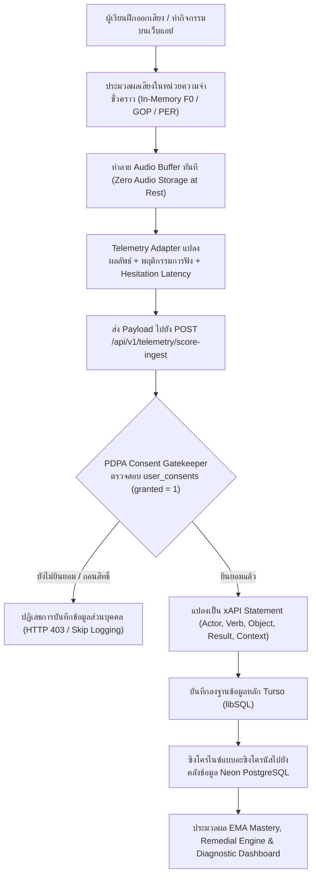
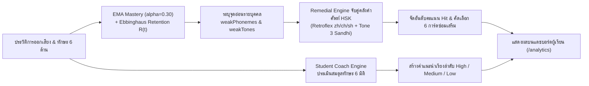
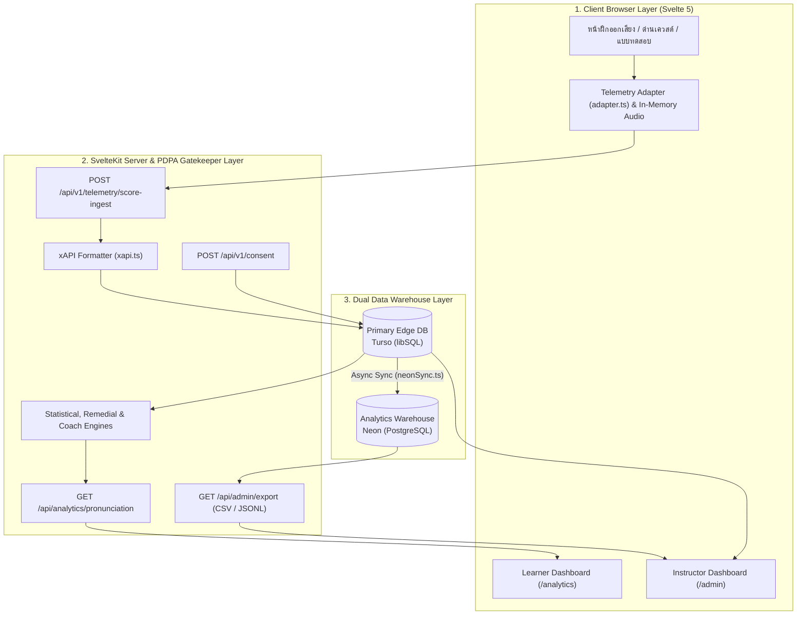
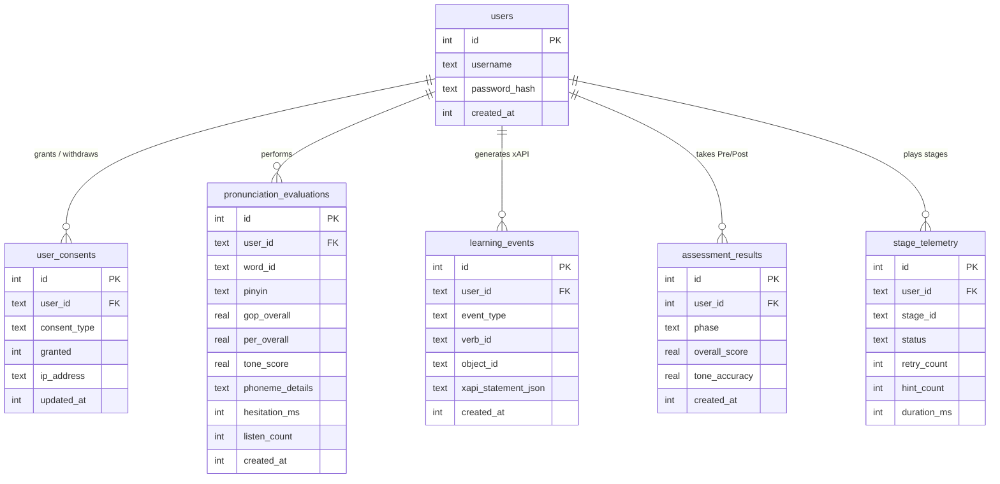

# บทที่ 4 การวิเคราะห์และออกแบบระบบ

ในบทนี้จะกล่าวถึงการวิเคราะห์ความต้องการของระบบ การกำหนดกรอบคำถามการเรียนรู้ (Learning Questions: LQ1–LQ8) การวิเคราะห์ขั้นตอนการทำงานของระบบ (Flowchart และ Algorithms) การออกแบบสถาปัตยกรรมระบบและคลังข้อมูลตามมาตรฐาน xAPI ภายใต้มาตรการคุ้มครองข้อมูลส่วนบุคคล (PDPA) การออกแบบส่วนติดต่อผู้ใช้ของแดชบอร์ดผู้เรียนและผู้สอน ตลอดจนการออกแบบเกณฑ์การวัดและประเมินผลการดำเนินงาน โดยมีรายละเอียดดังต่อไปนี้

---

## 4.1 ความต้องการของระบบและการกำหนดคำถามการเรียนรู้ (Learning Questions)

จากเป้าหมายของการพัฒนาระบบวิเคราะห์ข้อมูลการเรียนรู้และแดชบอร์ดวินิจฉัยการออกเสียงภาษาจีนเชิงสัทศาสตร์ตามมาตรฐาน xAPI ผู้จัดทำได้ร่วมกับพนักงานที่ปรึกษาในการกำหนดคำถามการเรียนรู้เชิงประจักษ์ (Learning Questions: LQ1–LQ8) เพื่อใช้เป็นตัวกำหนดทิศทางการออกแบบโครงสร้างข้อมูล Telemetry การสร้างอนุกรมวิธานความผิดพลาด และตัวชี้วัดบนแดชบอร์ดผู้เรียนและผู้สอน ดังแสดงในตารางที่ 4.1

### ตารางที่ 4.1 กรอบคำถามการเรียนรู้ (Learning Questions: LQ1–LQ8) และตัวชี้วัดที่ใช้ในการวิเคราะห์

| รหัส | คำถามการเรียนรู้ (Learning Question) | ตัวชี้วัดหลัก (Metrics) | แหล่งข้อมูล / โมดูลที่เกี่ยวข้อง |
| :-: | :--- | :--- | :--- |
| **LQ1** | หน่วยเสียงพยัญชนะต้น (Initials) และสระ (Finals) ใดที่ผู้เรียนชาวไทยออกเสียงผิดพลาดบ่อยที่สุด และเกิดการสับสนกับเสียงใด? | Phoneme Error Rate (PER), Substitution Frequency Matrix (เช่น `zh` $\rightarrow$ `z`) | `pronunciation_evaluations`, `phoneme_details` |
| **LQ2** | วรรณยุกต์ภาษาจีนกลางทั้ง 4 เสียง และกฎการเปลี่ยนเสียง (Tone Sandhi 3+3) เสียงใดมีความแม่นยำต่ำที่สุด? | Per-Tone Accuracy (%), Chao Scale Contour Deviation, Tone Confusion | `pronunciation_evaluations`, `tone_score` |
| **LQ3** | พฤติกรรมการกดฟังเสียงตัวอย่างก่อนพูดส่งผลต่อความแม่นยำในการออกเสียงและเวลาความลังเล (Hesitation Latency) หรือไม่? | Listening Impact Score Delta ($\Delta$), `listen_count`, `hesitation_ms` | `learning_events` (xAPI), `pronunciation_evaluations` |
| **LQ4** | ระดับความเชี่ยวชาญของผู้เรียนมีการพัฒนาและคงอยู่ตามกาลเวลาอย่างไร? | EMA Mastery Score ($M_t$), Ebbinghaus Retention $R(\Delta t)$ | `statisticalEngine.ts`, `remedialEngine.ts` |
| **LQ5** | ผู้เรียนติดขัดหรือเลิกเรียนกลางคัน (Drop-off) ที่ด่านใดและกิจกรรมรูปแบบใดในหลักสูตร HSK 1–3? | Stage Completion Funnel, Retry Count, Hint Usage Rate | `stage_telemetry`, `DropOffFunnelView.svelte` |
| **LQ6** | ทักษะทั้ง 6 มิติ (สัทศาสตร์, วรรณยุกต์, คัดอักษร, สนทนา AI, คำศัพท์, ด่านเควสต์) มีความสมดุลเพียงใดในระดับรายบุคคล? | 6-Axis Skill Radar Score (0–100%), Weakest Skill Priority | `studentCoachEngine.ts`, `/analytics` |
| **LQ7** | การแนะนำคำศัพท์ซ่อมเสริมแบบปรับเหมาะช่วยลดอัตราความผิดพลาดของจุดอ่อนรายบุคคลได้หรือไม่? | Target Weakness Match Precision (%), Post-Remedial Score Gain | `remedialEngine.ts`, `StudentSkillRadar.svelte` |
| **LQ8** | ผู้เรียนมีผลสัมฤทธิ์ทางการเรียนหลังใช้งานระบบ (Post-test) สูงกว่าก่อนเรียน (Pre-test) อย่างมีนัยสำคัญทางสถิติหรือไม่? | Paired Sample $t$-test, $p$-value, Cohen's $d$, Hake's Gain $\langle g \rangle$ | `assessment_results`, `statisticalEngine.ts` |

---

## 4.2 การวิเคราะห์ระบบการทำงาน

### 4.2.1 ผังงาน (Flowchart) การดักจับข้อมูลและการประมวลผล

เมื่อผู้เรียนทำการฝึกออกเสียงหรือทำกิจกรรมในแอปพลิเคชัน "语 ปากจีน" ระบบฝั่งไคลเอนต์ (`src/lib/telemetry/adapter.ts` และ `src/lib/telemetry/client.ts`) จะรวบรวมค่าการประเมินเสียงที่ประมวลผลในหน่วยความจำชั่วคราว (โดยไม่บันทึกไฟล์เสียงดิบ) พร้อมพฤติกรรมการฟังเสียงตัวอย่างและเวลาความลังเล ส่งไปยัง API `/api/v1/telemetry/score-ingest` จากนั้นระบบ **PDPA Consent Gatekeeper** จะตรวจสอบสถานะความยินยอมในตาราง `user_consents` หากผู้เรียนให้ความยินยอมแล้ว ระบบจะแปลงข้อมูลเป็นมาตรฐาน xAPI Statement ผ่านฟังก์ชัน `convertTelemetryToXApi()` และบันทึกลงฐานข้อมูล Turso (libSQL) พร้อมซิงโครไนซ์ไปยังคลังข้อมูล Neon PostgreSQL เพื่อนำไปประมวลผลบนแดชบอร์ดต่อไป ดังแสดงผังงานการทำงานในรูปที่ 4.1


**รูปที่ 4.1** ผังงาน (Flowchart) กระบวนการดักจับข้อมูล Telemetry การตรวจสอบความยินยอม PDPA และการประมวลผล Analytics

---

### 4.2.2 กระบวนการสร้างอนุกรมวิธานความผิดพลาด (Error Taxonomy) และการคำนวณตัววัดคุณภาพเสียง

ระบบการจำแนกความผิดพลาดทางสัทศาสตร์ (`src/lib/pronunciation.ts`) ทำหน้าที่แยกคำศัพท์พินอินเป้าหมายออกเป็นพยางค์ และแบ่งแต่ละพยางค์ออกเป็น 2 หน่วยเสียงย่อย ได้แก่ **พยัญชนะต้น (Initial / Shengmu)** จากชุดพยัญชนะมาตรฐาน 23 เสียง (โดยตรวจสอบพยัญชนะควบ 2 ตัวอักษร `zh`, `ch`, `sh` ก่อนพยัญชนะเดี่ยว `z`, `c`, `s`) และ **สระพร้อมวรรณยุกต์ (Final + Tone)** จากนั้นจึงเปรียบเทียบกับหน่วยเสียงที่ระบบรู้จำได้จริงและจำแนกสถานะความผิดพลาดออกเป็น 4 ประเภทตามอนุกรมวิธานความผิดพลาด (Error Taxonomy) ดังแสดงในตารางที่ 4.2

### ตารางที่ 4.2 อนุกรมวิธานความผิดพลาดทางสัทศาสตร์ (Error Taxonomy) และเกณฑ์การจำแนกสถานะ

| สถานะความผิดพลาด (Status) | ความหมายเชิงสัทศาสตร์ | เงื่อนไขการตรวจจับ | ตัวอย่างความผิดพลาดของผู้เรียนไทย |
| :--- | :--- | :--- | :--- |
| `correct` | ออกเสียงได้ถูกต้องตรงตามเป้าหมาย | `target === recognized` และคะแนน GOP $\ge$ เกณฑ์ | เป้าหมาย `sh` อ่านเป็น `sh` |
| `substitution` | ออกเสียงแทนที่หรือสับสนกับหน่วยเสียงอื่น | `target !== recognized` (ทั้งคู่ไม่เป็นค่าว่าง) | เป้าหมาย `zh` แต่ออกเสียงเป็น `z`, `ch` $\rightarrow$ `c` |
| `omission` | ออกเสียงตกหล่นหรือขาดหายไป | มีหน่วยเสียงเป้าหมาย แต่ `recognized` เป็นค่าว่าง | ตกหล่นพยัญชนะสะกดท้ายพยางค์ `-n` / `-ng` |
| `insertion` | มีเสียงแปลกปลอมแทรกเกินเข้ามา | ไม่มีหน่วยเสียงเป้าหมาย แต่ตรวจพบเสียงเกิน | แทรกเสียงสระเกินท้ายคำภาษาจีน |

สำหรับการคำนวณตัววัดคุณภาพการออกเสียงเชิงกำหนด (Deterministic Acoustic Metrics) ใน `src/lib/analytics/statisticalEngine.ts` ระบบคำนวณค่าตัวชี้วัดหลัก 3 ค่า ได้แก่
1. **อัตราความผิดพลาดของหน่วยเสียง ($\text{PER}$):** คำนวณจากสัดส่วนจำนวนหน่วยเสียงที่มีสถานะ `substitution`, `omission`, หรือ `insertion` หารด้วยจำนวนหน่วยเสียงเป้าหมายทั้งหมดในคำศัพท์
2. **คะแนนความชัดเจนและรูปร่างวรรณยุกต์ ($S_{\text{clarity}}$ และ $S_{\text{contour}}$):** ใช้ค่าความมั่นใจคาบเวลาจากอัลกอริทึม YIN ร่วมกับการแปลงความถี่ $F_0$ เป็นมาตรวัด Chao Scale 1–5 เพื่อตรวจสอบความสอดคล้องของระดับเสียงและทิศทางความชัน (Slope)
3. **คะแนน Goodness of Pronunciation ($\text{GOP}$):** คำนวณค่าเฉลี่ยถ่วงน้ำหนักระหว่างความแม่นยำของหน่วยเสียงพยัญชนะ สระ และความแม่นยำของวรรณยุกต์ ให้อยู่ในช่วง 0–100 คะแนน

---

### 4.2.3 อัลกอริทึมโมเดลผู้เรียนและระบบแนะนำคำศัพท์ซ่อมเสริม (Remedial & Student Coach Engine)

เพื่อเปลี่ยนผลวินิจฉัยเชิงสัทศาสตร์ให้เป็นแนวทางการฝึกซ่อมเสริมรายบุคคล ระบบประกอบด้วย 2 โมดูลหลักที่ทำงานร่วมกัน ดังแสดงผังงานอัลกอริทึมในรูปที่ 4.2

1. **โมเดลติดตามความเชี่ยวชาญ (EMA Mastery & Ebbinghaus Retention):** คำนวณระดับความเชี่ยวชาญของแต่ละหน่วยเสียงและคำศัพท์ด้วยสมการ $M_t = 0.30 \cdot S_t + 0.70 \cdot M_{t-1}$ ร่วมกับอัตราการคงอยู่ของความจำ $R(\Delta t) = e^{-\Delta t / S_{\text{stability}}}$ เพื่อระบุหน่วยเสียงที่ผู้เรียนยังคงอ่อน (`weakPhonemes`) และวรรณยุกต์ที่ควรฝึกซ้ำ (`weakTones`)
2. **ระบบแนะนำคำศัพท์ซ่อมเสริม (`src/lib/analytics/remedialEngine.ts`):** นำรายการจุดอ่อน (`weakPhonemes` และ `weakTones`) มาจับคู่กับคลังคำศัพท์ HSK 1–3 ทั้ง 1,000 คำ โดยให้คะแนนลำดับความสำคัญแบบถ่วงน้ำหนัก คำศัพท์ที่ตรงทั้งพยัญชนะต้นที่เป็นจุดอ่อนและวรรณยุกต์ที่เป็นจุดอ่อน (รวมถึงคำที่มีกฎ Tone Sandhi 3+3 เมื่อวรรณยุกต์เสียงที่ 3 อ่อน) จะถูกจัดอันดับสูงสุดและคัดเลือกมาสูงสุด 6 การ์ด พร้อมคำอธิบายเหตุผลภาษาไทยที่เข้าใจง่าย
3. **ระบบโค้ชผู้เรียนอัจฉริยะ (`src/lib/analytics/studentCoachEngine.ts`):** รวบรวมข้อมูลทักษะทั้ง 6 ด้านของผู้เรียน (GOP, วรรณยุกต์ 4 เสียง, คัดอักษรจีน, บทสนทนา AI, ความจำ Flashcard, และด่าน Quest) มาสร้างคำแนะนำเชิงปฏิบัติการเรียงตามระดับความเร่งด่วน (`high`, `medium`, `low`)


**รูปที่ 4.2** ผังงานอัลกอริทึมการจำแนกข้อผิดพลาด (Error Taxonomy) และการคัดเลือกคำศัพท์ซ่อมเสริม (Adaptive Remedial Engine)

---

## 4.3 การออกแบบระบบงาน

### 4.3.1 สถาปัตยกรรมระบบ (System Architecture)

ระบบวิเคราะห์ข้อมูลการเรียนรู้ได้รับการออกแบบในลักษณะ **คลังข้อมูลแบบสองชั้นและสถาปัตยกรรมแยกส่วนความรับผิดชอบ (Dual-Database xAPI Telemetry Architecture)** โดยแบ่งออกเป็น 3 ชั้น ได้แก่
1. **ชั้นส่วนหน้าและการดักจับข้อมูล (Client & Telemetry Adapter Layer):** ทำงานบนเว็บเบราว์เซอร์ด้วย SvelteKit รับผิดชอบการสกัดค่าเสียงในหน่วยความจำ แปลงผลลัพธ์ผ่าน `adapter.ts` และแสดงผลแดชบอร์ดผู้เรียน/ผู้สอน
2. **ชั้นประมวลผลและคัดกรองความปลอดภัย (SvelteKit API & PDPA Gatekeeper Layer):** ประกอบด้วย Endpoint `/api/v1/consent`, `/api/v1/telemetry/score-ingest`, `/api/v1/telemetry/stage-event`, `/api/analytics/pronunciation`, และ `/api/admin/export` ที่ตรวจสอบสิทธิ์ Session, Rate Limiting และความยินยอม PDPA ก่อนเขียนข้อมูล
3. **ชั้นคลังข้อมูลสองชั้น (Dual Data Warehouse Layer):** ใช้ฐานข้อมูลหลัก **Turso (libSQL)** เพื่อความเร็วในการเขียน-อ่านแบบ Edge Latency ต่ำ และซิงโครไนซ์ข้อมูลวิจัยไปยัง **Neon (Serverless PostgreSQL)** เพื่อรองรับการสืบค้นเชิงวิเคราะห์ขนาดใหญ่และการส่งออกข้อมูลวิจัยในรูปแบบ CSV และ JSONL ดังแสดงสถาปัตยกรรมระบบในรูปที่ 4.3


**รูปที่ 4.3** สถาปัตยกรรมระบบวิเคราะห์ข้อมูลการเรียนรู้และคลังข้อมูลแบบสองชั้น (Dual-Database xAPI Architecture)

---

### 4.3.2 การออกแบบโครงสร้างข้อมูล xAPI Schema และพจนานุกรมฐานข้อมูล (Data Dictionary)

ในการจัดเก็บข้อมูลกิจกรรมการเรียนรู้ตามมาตรฐาน ADL xAPI 1.0.3 (IEEE 9274.1.1) ระบบได้กำหนดโครงสร้างการจับคู่เหตุการณ์การออกเสียงและการฝึกฝนออกเป็น 3 กริยามาตรฐาน ได้แก่ `experienced` (การกดฟังเสียงตัวอย่าง), `attempted` (การฝึกออกเสียงระดับพยางค์) และ `scored` (ผลการประเมินรวมระดับคำศัพท์) ดังแสดงรายละเอียดในตารางที่ 4.3

### ตารางที่ 4.3 โครงสร้างการจับคู่เหตุการณ์ xAPI Statement (Actor, Verb, Object, Result, Context)

| องค์ประกอบ xAPI | ชนิดเหตุการณ์ / ฟิลด์ข้อมูล | รายละเอียดและการจับคู่ค่าจากระบบ |
| :--- | :--- | :--- |
| **Actor** | `account.name` / `account.homePage` | รหัสผู้ใช้แบบแฝงตัวตน (`userId`) ภายใต้โดเมนหลักของแพลตฟอร์ม |
| **Verb (Listening)** | `http://adlnet.gov/expapi/verbs/experienced` | บันทึกเมื่อผู้เรียนกดฟังเสียงตัวอย่างก่อนพูด (`listenedToExample = true`) |
| **Verb (Syllable)** | `http://adlnet.gov/expapi/verbs/attempted` | บันทึกการออกเสียงรายพยางค์ (เป้าหมายวรรณยุกต์เทียบกับวรรณยุกต์ที่ตรวจพบ) |
| **Verb (Overall)** | `http://adlnet.gov/expapi/verbs/scored` | บันทึกผลคะแนนรวมระดับคำศัพท์ (`raw`, `scaled`, `success`, `completion`) |
| **Object** | `id` / `definition.name` / `type` | รหัสคำศัพท์ URI (`word.id`), ตัวอักษรจีนและพินอิน (`word.hanzi`, `word.pinyin`) |
| **Result Extensions** | `gop`, `per`, `avgF0`, `phoneme_details` | ส่วนขยายคะแนนสัทศาสตร์และความถี่มูลฐานเฉลี่ย (ปราศจากไฟล์เสียงดิบ) |
| **Context Extensions** | `practiceMode`, `stageId`, `listenCount` | โหมดการฝึก (`stage`, `word`, `assessment`), รหัสด่าน และจำนวนครั้งที่ฟังตัวอย่าง |

สำหรับโครงสร้างฐานข้อมูลเชิงสัมพันธ์ในคลังข้อมูลการเรียนรู้ สามารถแสดงความสัมพันธ์ระหว่างตารางข้อมูลหลัก (Entity-Relationship Diagram: ERD) ได้ดังรูปที่ 4.4


**รูปที่ 4.4** แผนภาพความสัมพันธ์ของข้อมูล (Entity-Relationship Diagram: ERD) ในคลังข้อมูลการเรียนรู้

ทั้งนี้ รายละเอียดพจนานุกรมข้อมูล (Data Dictionary) ของตารางสำคัญทั้ง 6 ตาราง ได้แก่ `users`, `user_consents`, `pronunciation_evaluations`, `learning_events`, `assessment_results`, และ `stage_telemetry` แสดงไว้ในตารางที่ 4.4 ถึงตารางที่ 4.9 ตามลำดับ

### ตารางที่ 4.4 พจนานุกรมข้อมูลตาราง `users` (ข้อมูลบัญชีผู้ใช้งาน)

| ชื่อคอลัมน์ | ชนิดข้อมูล | คีย์ | ข้อกำหนด | คำอธิบาย |
| :--- | :---: | :---: | :--- | :--- |
| `id` | `INTEGER` | PK | `AUTOINCREMENT` | รหัสประจำตัวผู้เรียนอัตโนมัติ |
| `username` | `TEXT` | UNIQUE | `NOT NULL, COLLATE NOCASE` | ชื่อบัญชีผู้ใช้สำหรับเข้าสู่ระบบ |
| `password_hash` | `TEXT` | - | `NOT NULL` | รหัสผ่านที่ผ่านการเข้ารหัสแบบ PBKDF2/Scrypt |
| `created_at` | `INTEGER` | - | `NOT NULL` | เวลาที่สร้างบัญชี (Unix Timestamp มิลลิวินาที) |

### ตารางที่ 4.5 พจนานุกรมข้อมูลตาราง `user_consents` (บันทึกความยินยอม PDPA)

| ชื่อคอลัมน์ | ชนิดข้อมูล | คีย์ | ข้อกำหนด | คำอธิบาย |
| :--- | :---: | :---: | :--- | :--- |
| `id` | `INTEGER` | PK | `AUTOINCREMENT` | รหัสลำดับบันทึกความยินยอม |
| `user_id` | `TEXT` | FK | `NOT NULL` | รหัสผู้เรียนที่ให้ความยินยอม |
| `consent_type` | `TEXT` | - | `DEFAULT 'pdpa_research_telemetry'` | ประเภทความยินยอมด้านการวิจัยและ Telemetry |
| `granted` | `INTEGER` | - | `NOT NULL` | สถานะความยินยอม (`1` = ยินยอม, `0` = ถอนความยินยอม) |
| `ip_address` | `TEXT` | - | Nullable | ค่าแฮชของที่อยู่ IP สำหรับตรวจสอบย้อนกลับ |
| `updated_at` | `INTEGER` | - | `NOT NULL` | เวลาที่อัปเดตสถานะความยินยอมล่าสุด |

### ตารางที่ 4.6 พจนานุกรมข้อมูลตาราง `pronunciation_evaluations` (ผลการประเมินการออกเสียงระดับหน่วยเสียง)

| ชื่อคอลัมน์ | ชนิดข้อมูล | คีย์ | ข้อกำหนด | คำอธิบาย |
| :--- | :---: | :---: | :--- | :--- |
| `id` | `INTEGER` | PK | `AUTOINCREMENT` | รหัสผลการประเมินการออกเสียง |
| `user_id` | `TEXT` | FK, IDX | `NOT NULL` | รหัสผู้เรียนที่ทำการฝึกออกเสียง |
| `word_id` | `TEXT` | - | `NOT NULL` | รหัสคำศัพท์เป้าหมาย (เช่น `hsk1_001`) |
| `pinyin` | `TEXT` | - | `NOT NULL` | พินอินเป้าหมายพร้อมเครื่องหมายวรรณยุกต์ |
| `gop_overall` | `REAL` | - | `NOT NULL` | คะแนนความแม่นยำ Goodness of Pronunciation (0–100) |
| `per_overall` | `REAL` | - | `NOT NULL` | อัตราความผิดพลาดของหน่วยเสียง Phoneme Error Rate (0.0–1.0) |
| `tone_score` | `REAL` | - | `NOT NULL` | คะแนนความถูกต้องของรูปร่างวรรณยุกต์ (0–100) |
| `phoneme_details` | `TEXT` | - | `NOT NULL` | ข้อมูล JSON แสดงรายการ Error Taxonomy รายหน่วยเสียง |
| `hesitation_ms` | `INTEGER` | - | `DEFAULT 0` | ระยะเวลาความลังเลก่อนเริ่มพูด (มิลลิวินาที) |
| `listen_count` | `INTEGER` | - | `DEFAULT 0` | จำนวนครั้งที่ผู้เรียนกดฟังเสียงตัวอย่างก่อนพูด |
| `clarity` | `REAL` | - | `DEFAULT 0` | คะแนนความชัดเจนสัญญาณคาบเวลาจากอัลกอริทึม YIN |
| `created_at` | `INTEGER` | - | `NOT NULL` | เวลาที่ประเมินผล (Unix Timestamp) |

### ตารางที่ 4.7 พจนานุกรมข้อมูลตาราง `learning_events` (คลังจัดเก็บข้อมูลมาตรฐาน xAPI LRS)

| ชื่อคอลัมน์ | ชนิดข้อมูล | คีย์ | ข้อกำหนด | คำอธิบาย |
| :--- | :---: | :---: | :--- | :--- |
| `id` | `INTEGER` | PK | `AUTOINCREMENT` | รหัสลำดับเหตุการณ์การเรียนรู้ |
| `user_id` | `TEXT` | FK | `NOT NULL` | รหัสผู้เรียนเจ้าของเหตุการณ์ |
| `event_type` | `TEXT` | - | `NOT NULL` | ประเภทเหตุการณ์ (เช่น `pronunciation_evaluation`) |
| `verb_id` | `TEXT` | - | `NOT NULL` | URI ของกริยาตามมาตรฐาน ADL xAPI |
| `object_id` | `TEXT` | - | `NOT NULL` | URI ของวัตถุการเรียนรู้เป้าหมาย |
| `xapi_statement_json` | `TEXT` | - | `NOT NULL` | ข้อมูล xAPI Statement ฉบับเต็มในรูปแบบ JSON |
| `created_at` | `INTEGER` | - | `NOT NULL` | เวลาที่บันทึกเหตุการณ์ |

### ตารางที่ 4.8 พจนานุกรมข้อมูลตาราง `assessment_results` (ผลการทดสอบวัดระดับ Pre-test และ Post-test)

| ชื่อคอลัมน์ | ชนิดข้อมูล | คีย์ | ข้อกำหนด | คำอธิบาย |
| :--- | :---: | :---: | :--- | :--- |
| `id` | `INTEGER` | PK | `AUTOINCREMENT` | รหัสผลการทดสอบวัดระดับ |
| `user_id` | `INTEGER` | FK | `NOT NULL` | รหัสผู้เรียนที่เข้าทำแบบทดสอบ |
| `phase` | `TEXT` | - | `NOT NULL` | ระยะของการทดสอบ (`pre` หรือ `post`) |
| `overall_score` | `REAL` | - | `NOT NULL` | คะแนนรวมผลการทดสอบวัดระดับการออกเสียง (0–100) |
| `tone_accuracy` | `REAL` | - | `NOT NULL` | ความแม่นยำวรรณยุกต์ในการทดสอบ (%) |
| `created_at` | `INTEGER` | - | `NOT NULL` | เวลาที่ส่งคำตอบแบบทดสอบ |

### ตารางที่ 4.9 พจนานุกรมข้อมูลตาราง `stage_telemetry` (ข้อมูลพฤติกรรมการเรียนรู้ระดับด่านเควสต์)

| ชื่อคอลัมน์ | ชนิดข้อมูล | คีย์ | ข้อกำหนด | คำอธิบาย |
| :--- | :---: | :---: | :--- | :--- |
| `id` | `INTEGER` | PK | `AUTOINCREMENT` | รหัสบันทึกพฤติกรรมระดับด่าน |
| `user_id` | `TEXT` | FK | `NOT NULL` | รหัสผู้เรียน |
| `stage_id` | `TEXT` | - | `NOT NULL` | รหัสด่านในหลักสูตร HSK 1–3 |
| `status` | `TEXT` | - | `NOT NULL` | สถานะการเล่น (`started`, `completed`, `abandoned`) |
| `retry_count` | `INTEGER` | - | `DEFAULT 0` | จำนวนครั้งที่ผู้เรียนลองทำซ้ำในด่านนั้น |
| `hint_count` | `INTEGER` | - | `DEFAULT 0` | จำนวนครั้งที่ผู้เรียนกดขอคำใบ้ |
| `duration_ms` | `INTEGER` | - | `DEFAULT 0` | ระยะเวลาที่ใช้ในด่าน (มิลลิวินาที) |

---

### 4.3.3 การออกแบบส่วนติดต่อผู้ใช้ (User Interface Design)

ในการออกแบบส่วนติดต่อผู้ใช้ (UI) สำหรับระบบวิเคราะห์ข้อมูลการเรียนรู้และแดชบอร์ดวินิจฉัย ผู้จัดทำได้ออกแบบหน้าจอสำคัญ 3 ส่วนหลัก ได้แก่

1. **หน้าจอขอความยินยอมคุ้มครองข้อมูลส่วนบุคคล (PDPA Consent Gatekeeper Modal):** ออกแบบให้แสดงรายละเอียดวัตถุประสงค์การเก็บข้อมูลเชิงตัวเลขตามมาตรฐาน xAPI และการรับรองว่าไม่บันทึกไฟล์เสียงดิบ (Zero Audio Storage) พร้อมปุ่มเลือก "ยินยอมให้เก็บข้อมูลเพื่อพัฒนาการเรียนรู้" และ "ไม่ยินยอม (ใช้งานต่อโดยไม่บันทึกข้อมูลวิจัย)" รวมถึงปุ่มถอนความยินยอมได้ตลอดเวลา ดังโครงร่างการออกแบบในรูปที่ 4.5
2. **หน้าจอแดชบอร์ดสำหรับผู้เรียน (`/analytics`):** แสดงแผนภูมิเรดาร์ทักษะ 6 มิติ (6-Axis Skill Radar) การ์ดคำแนะนำจาก AI Coach ที่เรียงตามความสำคัญ การ์ดคำศัพท์ซ่อมเสริมรายบุคคลพร้อมคู่มือการจัดวางลิ้นและอวัยวะออกเสียง (`articulationGuides.ts`) และกราฟสรุปความแม่นยำรายวรรณยุกต์ ดังโครงร่างการออกแบบในรูปที่ 4.6
3. **หน้าจอแดชบอร์ดวินิจฉัยสำหรับผู้สอนและผู้ดูแลระบบ (`/admin`):** แบ่งเป็น 12 มุมมองการวิเคราะห์ (Cohort Overview, Pronunciation Error Matrix, Drop-off Funnel, Hardest Words, Pre/Post-test Statistical Analysis, Learner 360 Profile และปุ่มส่งออกข้อมูล CSV/JSONL) ดังโครงร่างการออกแบบในรูปที่ 4.7

```
+-------------------------------------------------------------------------+
| [โลโก้] ประกาศความเป็นส่วนตัวและขอความยินยอมข้อมูลการเรียนรู้ (PDPA)      |
|-------------------------------------------------------------------------|
| ระบบ "语 ปากจีน" เก็บเฉพาะค่าคะแนนเชิงสัทศาสตร์ (GOP, PER, F0, xAPI)      |
| [x] ไม่มีการบันทึกและจัดเก็บไฟล์เสียงพูดดิบ (Zero Audio Storage at Rest)  |
| [x] ข้อมูลถูกใช้เพื่อวิเคราะห์จุดอ่อนและแนะนำบทเรียนซ่อมเสริมเท่านั้น         |
|                                                                         |
|    [ ยินยอมและเริ่มบันทึกสถิติ ]        [ ไม่ยินยอม (ใช้งานโหมดส่วนตัว) ]    |
+-------------------------------------------------------------------------+
```
**รูปที่ 4.5** การออกแบบหน้าจอขอความยินยอมคุ้มครองข้อมูลส่วนบุคคล (PDPA Consent Gatekeeper Modal)

```
+-------------------------------------------------------------------------+
| แดชบอร์ดพัฒนาการผู้เรียน (/analytics)                                     |
|-------------------------------------------------------------------------|
| [ 6-Axis Skill Radar (SVG) ]   | [ AI Coach Recommendations ]           |
|  - ความชัดสัทศาสตร์ (GOP)       |  ! [High] ฝึกพยัญชนะม้วนลิ้น zh/ch/sh    |
|  - วรรณยุกต์ 4 เสียง            |  * [Med] ทบทวนวรรณยุกต์เสียงที่ 3 (214)  |
|  - คัดอักษรจีน / สนทนา AI      |                                        |
|-------------------------------------------------------------------------|
| [ การ์ดคำศัพท์ซ่อมเสริม (Adaptive Remedial Cards - สูงสุด 6 คำ) ]         |
|  [ 知识 zhī shi ] เหตุผล: แก้ออกเสียงสับสนพยัญชนะม้วนลิ้น /zh/ (สับกับ /z/) |
|  [ 你好 nǐ hǎo ]  เหตุผล: ฝึกกดระดับเสียงต่ำของเสียงที่ 3 และกฎ 3+3 Sandhi |
+-------------------------------------------------------------------------+
```
**รูปที่ 4.6** การออกแบบหน้าจอแดชบอร์ดสำหรับผู้เรียน แสดงเรดาร์ทักษะ 6 มิติ (6-Axis Skill Radar) และคำแนะนำจาก AI Coach

```
+-------------------------------------------------------------------------+
| Instructor & Cohort Diagnostic Dashboard (/admin)  [Export CSV] [JSONL] |
|-------------------------------------------------------------------------|
| Tabs: [ภาพรวม] [วินิจฉัยออกเสียง] [Pre/Post t-test] [Drop-off] [ผู้ใช้ 360] |
|-------------------------------------------------------------------------|
| [ สรุปผลกลุ่มเรียน (Cohort KPIs) ]                                      |
|  ผู้เรียนทั้งหมด: N คน | คะแนนเฉลี่ย GOP: XX% | Paired t-test: p < .001  |
|-------------------------------------------------------------------------|
| [ กราฟ Error Taxonomy Breakdown & Confusion Matrix ]                    |
|  - พยัญชนะผิดบ่อย: zh->z (XX%), sh->s (XX%)  | วรรณยุกต์อ่อน: Tone 3   |
+-------------------------------------------------------------------------+
```
**รูปที่ 4.7** การออกแบบหน้าจอแดชบอร์ดวินิจฉัยสำหรับผู้สอนและผู้ดูแลระบบ (Instructor & Cohort Diagnostic Dashboard)

---

## 4.4 การออกแบบการวัดและประเมินผลการดำเนินงาน

เพื่อประเมินประสิทธิภาพของระบบที่พัฒนาขึ้นอย่างครอบคลุมทั้งเชิงเทคนิค เชิงผลสัมฤทธิ์ทางการเรียน และเชิงความพึงพอใจของผู้ใช้งาน ผู้จัดทำได้กำหนดเกณฑ์การวัดและประเมินผลออกเป็น 3 ด้าน ดังนี้

1. **การประเมินความถูกต้องของท่อส่งข้อมูล xAPI Telemetry และมาตรการ PDPA:** ตรวจสอบความสมบูรณ์ของโครงสร้าง JSON ตามมาตรฐาน xAPI 1.0.3 (Actor, Verb, Object, Result, Context) อัตราความสำเร็จของการปฏิเสธข้อมูลเมื่อผู้ใช้ยังไม่ให้ความยินยอม (100% Gatekeeper Enforcement) และการตรวจสอบคลังข้อมูล Turso และ Neon เพื่อยืนยันว่าไม่มีการจัดเก็บไฟล์เสียงดิบ (0 Audio Blobs Stored)
2. **การประเมินผลสัมฤทธิ์ทางการเรียน (Pre-test / Post-test Evaluation):** นำผลคะแนนทดสอบก่อนเรียนและหลังเรียนของผู้เรียนกลุ่มทดลองมาวิเคราะห์ด้วยโมดูล `statisticalEngine.ts` เพื่อหาค่าเฉลี่ย ($\bar{X}$), ส่วนเบี่ยงเบนมาตรฐาน ($S.D.$), สถิติทดสอบ Paired Sample $t$-test ที่ระดับนัยสำคัญทางสถิติ $\alpha = 0.01$, ขนาดอิทธิพล Cohen's $d$, และค่าพัฒนาการสัมพัทธ์ Hake's Normalized Gain ($\langle g \rangle$)
3. **การประเมินความพึงพอใจและการใช้งานระบบ (Usability & Satisfaction Evaluation):** ใช้แบบสอบถามมาตราส่วนประมาณค่า 5 ระดับ (Likert Scale) โดยกำหนดเกณฑ์การแปลความหมายระดับคะแนนเฉลี่ยดังแสดงในตารางที่ 4.10

### ตารางที่ 4.10 เกณฑ์การแปลความหมายระดับคะแนนความพึงพอใจและประสิทธิภาพการใช้งาน (Likert Scale 5 ระดับ)

| ช่วงคะแนนเฉลี่ย ($\bar{X}$) | ระดับความพึงพอใจ / ประสิทธิภาพ | ความหมายในการแปลผล |
| :---: | :---: | :--- |
| **4.51 – 5.00** | มากที่สุด | ระบบมีประสิทธิภาพและตอบสนองความต้องการของผู้ใช้งานในระดับดีเยี่ยม |
| **3.51 – 4.50** | มาก | ระบบทำงานได้ดี ใช้งานง่าย และเป็นประโยชน์ต่อการเรียนการสอน |
| **2.51 – 3.50** | ปานกลาง | ระบบทำงานได้ตามมาตรฐาน แต่ยังมีบางส่วนที่ควรปรับปรุงเพิ่มเติม |
| **1.51 – 2.50** | น้อย | ระบบมีข้อจำกัดหรือความซับซ้อนที่ส่งผลกระทบต่อการใช้งาน |
| **1.00 – 1.50** | น้อยที่สุด | ระบบยังไม่พร้อมใช้งานและจำเป็นต้องได้รับการแก้ไขเร่งด่วน |
