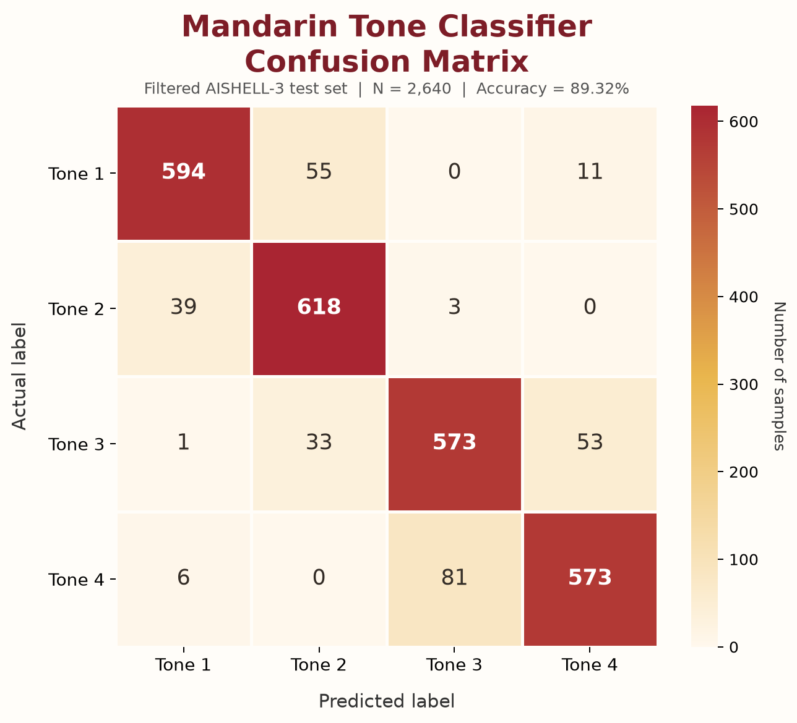

# Mandarin Tone Classifier Benchmark

## Result Summary

| Metric | Measured result |
| --- | ---: |
| Model evaluated | `static/models/mandarin_tone_cnn.onnx` |
| Evaluation examples | 2,640 |
| Correct predictions | 2,358 |
| Incorrect predictions | 282 |
| Accuracy | 89.3182% (89.32% rounded to 2 decimals) |
| Test examples per tone | 660 |

These results were measured by running the ONNX model currently present in the repository against `scripts/aishell3_test_cache.npz`. The confusion matrix below is from that inference run, not a manually estimated result.

## Evaluation Data and Filtering

The cached test set contains 8,000 extracted examples, balanced at 2,000 examples for each tone. The benchmark applies the acoustic quality gates implemented by `filter_clean_contours` in `scripts/train_aishell3.py`:

- Tone 1: mean pitch at least 3.2 and absolute end-to-start pitch difference no greater than 0.8.
- Tone 2: end pitch at least 0.18 above start pitch and end pitch at least 2.6.
- Tone 3: mean pitch no greater than 3.2 and minimum pitch no greater than 2.6.
- Tone 4: start pitch at least 3.2 and end-to-start drop at least 0.7.

The number passing each gate before balancing was 1,286 for Tone 1, 660 for Tone 2, 1,082 for Tone 3, and 1,170 for Tone 4. To balance the evaluation set, the implementation takes 660 examples from each tone, giving 2,640 examples total. Therefore, 8,000 is the size of the original cached test set, not the sample count used for the reported confusion matrix.

## Confusion Matrix

Rows are actual labels and columns are predicted labels. Each row has 660 examples.

| Actual \\ Predicted | Tone 1 | Tone 2 | Tone 3 | Tone 4 | Support |
| --- | ---: | ---: | ---: | ---: | ---: |
| Tone 1 (陰平, high level) | **594** | 55 | 0 | 11 | 660 |
| Tone 2 (陽平, rising) | 39 | **618** | 3 | 0 | 660 |
| Tone 3 (上聲, dipping/low) | 1 | 33 | **573** | 53 | 660 |
| Tone 4 (去聲, falling) | 6 | 0 | 81 | **573** | 660 |
| **Predicted total** | **640** | **706** | **657** | **637** | **2,640** |

Diagonal cells are correct predictions. Off-diagonal cells are errors. The model correctly classified 2,358 examples and misclassified 282.

## Per-Tone Metrics

Precision is calculated as TP / predicted count; recall is TP / actual support; F1 is the harmonic mean of precision and recall. Values below are calculated from the confusion matrix and shown to four decimal places.

| Tone | Precision | Recall | F1-score | Support | Incorrect |
| --- | ---: | ---: | ---: | ---: | ---: |
| Tone 1 | 0.9281 | 0.9000 | 0.9138 | 660 | 66 |
| Tone 2 | 0.8754 | 0.9364 | 0.9048 | 660 | 42 |
| Tone 3 | 0.8721 | 0.8682 | 0.8702 | 660 | 87 |
| Tone 4 | 0.8995 | 0.8682 | 0.8836 | 660 | 87 |
| **Macro average** | **0.8938** | **0.8932** | **0.8931** | **2,640** | **282** |
| **Weighted average** | **0.8938** | **0.8932** | **0.8931** | **2,640** | **282** |

Because all four classes have equal support, macro and weighted averages are equal apart from rounding.

## Error Breakdown

| Actual tone | Most frequent confusion | Count |
| --- | --- | ---: |
| Tone 1 | Predicted as Tone 2 | 55 |
| Tone 2 | Predicted as Tone 1 | 39 |
| Tone 3 | Predicted as Tone 4 | 53 |
| Tone 4 | Predicted as Tone 3 | 81 |

The largest pairwise confusion in this evaluation is Tone 4 predicted as Tone 3 (81 examples). This is a description of this test result, not a claim about all speakers or recording conditions.

## Reproduction and Scope

The reported predictions were generated with ONNX Runtime 1.31.0 using the CPU execution provider. Input and output metadata from the model were `pitch_input` with shape `[1, 2, 50]` and `tone_logits` with shape `[1, 4]`. The predicted class was the index of the largest output logit. Filtering used the repository's quality-gate thresholds and balanced the passing examples to the smallest passing class count.

This benchmark evaluates the checked-in ONNX artifact on cached AISHELL-3-derived features after filtering. It does not by itself establish accuracy on Thai learners, noisy real-world recordings, or an untouched blind test set. The repository's `scripts/split_blind_test.py` describes a separate blind-test workflow, but this report does not claim that workflow was used here.

No previous-model run on the same split and protocol was available to verify an improvement percentage. No inference-latency measurement was made in this evaluation. Accordingly, this report makes no quantitative claim that filtering improved accuracy over a baseline and no latency claim.
